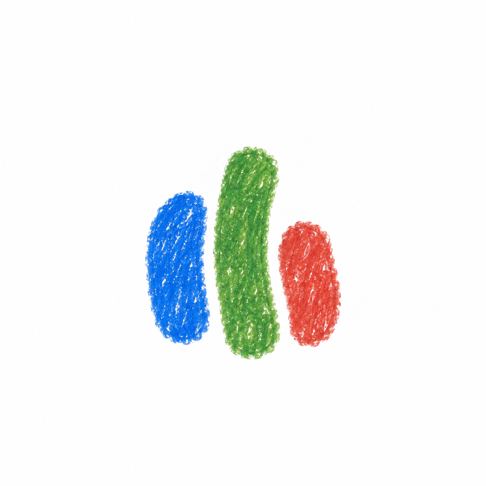
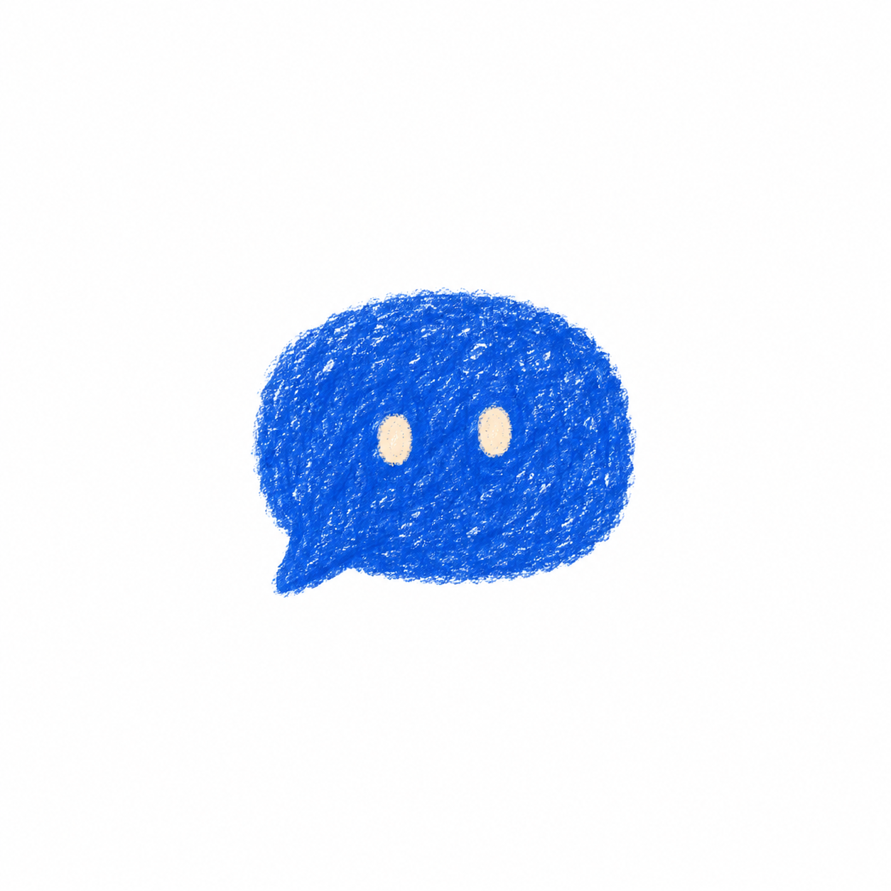
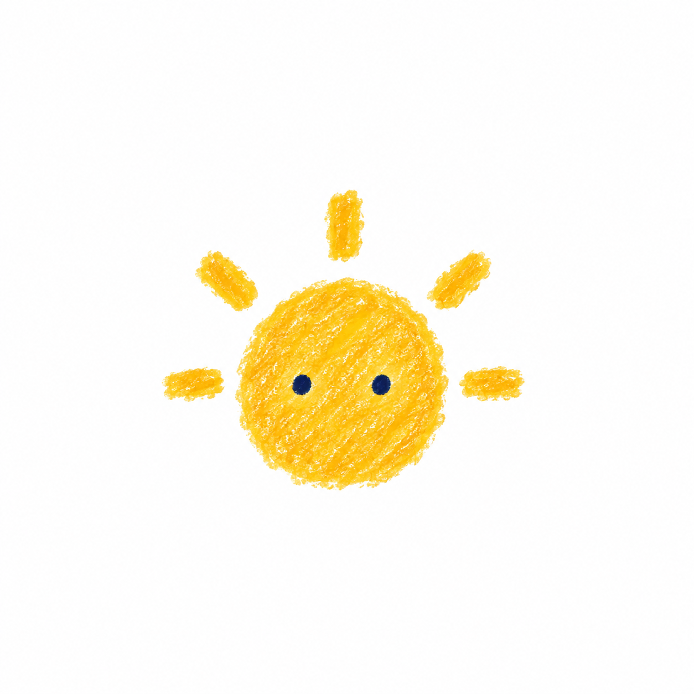
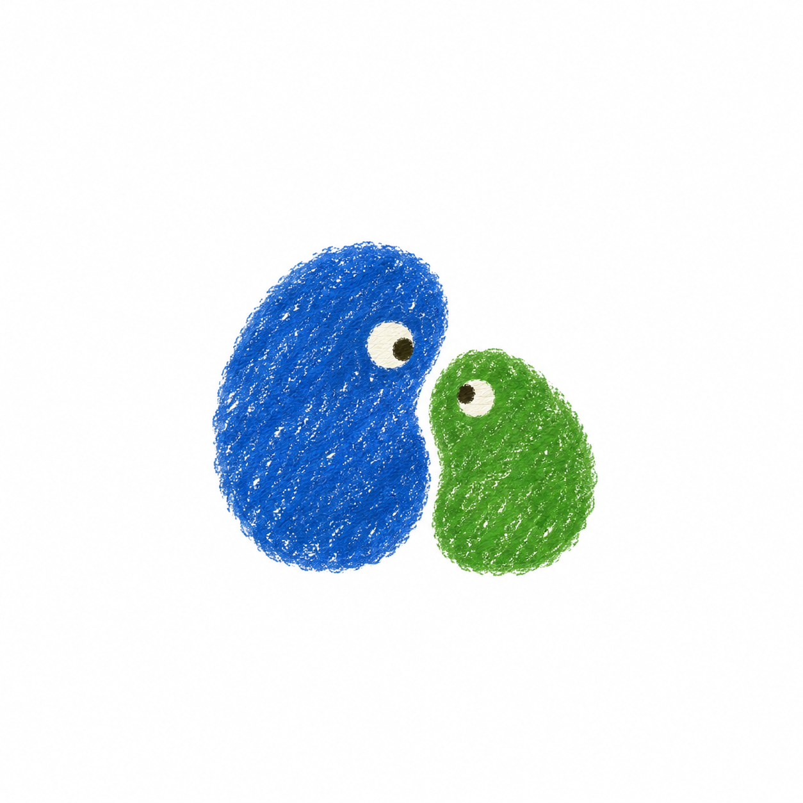
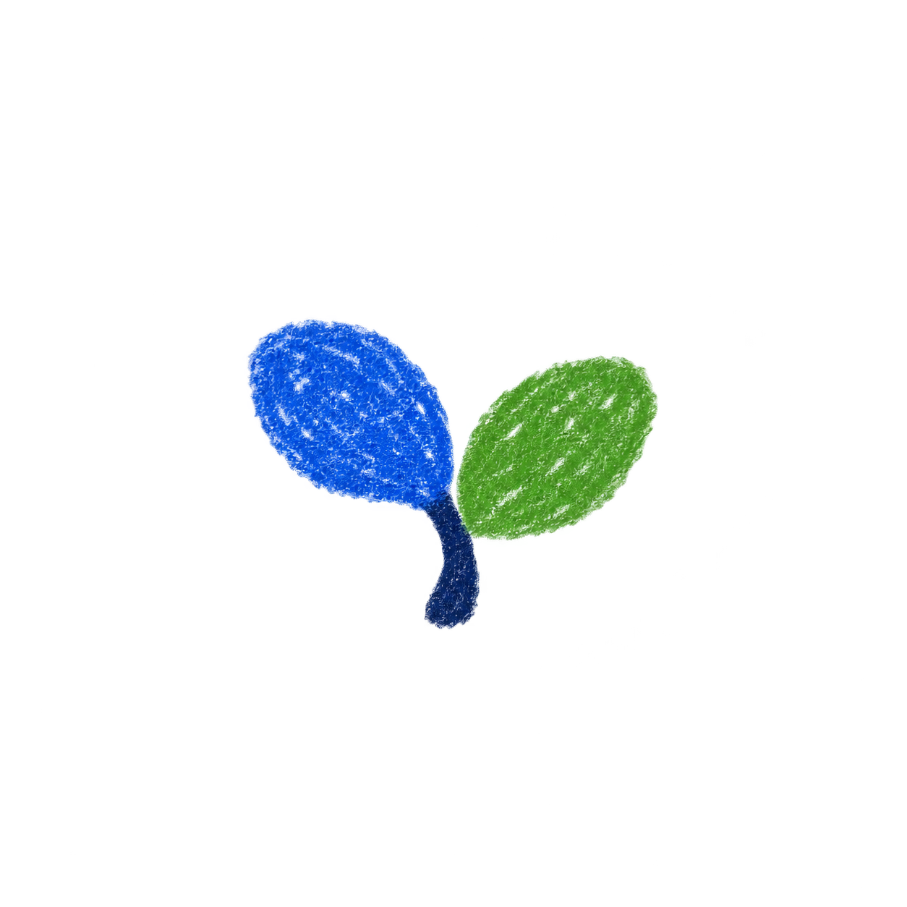

# Chit avatar concepts

Generated with the built-in image generation tool on 2026-09-19. Ideation assets, not integrated into the app.

## 01-crayon-wave

### Generation prompt

Use case: stylized-concept. Generate one minimalist avatar concept for Chit, a relaxed voice conversation companion in a language-practice web app. Square white paper canvas, a single small centered symbol occupying about 40 percent of canvas width with generous whitespace. Naive illustrated-diary aesthetic, authentic wax crayon and dry oil pastel: dense overlapping short marks, visible tiny white paper gaps inside pigment, soft ragged edges. Flat rich colors, warm playful quiet personality. Extremely simple recognizable silhouette readable at 48px, suitable for later gentle voice-reactive animation. No lettering, labels, UI, borders, gradients, shadows, 3D, glossy finish, vector-smooth edges, arms or legs. Exactly three separate chunky upright crayon strokes, uneven rounded ends and different heights, gently leaning like friends. Cobalt blue left, leafy green middle, warm tomato red right. An organic little sound wave, not polished equalizer bars. No face.

## 02-chat-pebble

### Generation prompt

Use case: stylized-concept. Generate one minimalist avatar concept for Chit, a relaxed voice conversation companion in a language-practice web app. Square white paper canvas, a single small centered symbol occupying about 40 percent of canvas width with generous whitespace. Naive illustrated-diary aesthetic, authentic wax crayon and dry oil pastel: dense overlapping short marks, visible tiny white paper gaps inside pigment, soft ragged edges. Flat rich colors, warm playful quiet personality. Extremely simple recognizable silhouette readable at 48px, suitable for later gentle voice-reactive animation. No lettering, labels, UI, borders, gradients, shadows, 3D, glossy finish, vector-smooth edges, arms or legs. One squat rounded cobalt-blue speech-bubble pebble, softly irregular with a tiny integrated tail at bottom left. Two tiny cream-colored oval eyes, no mouth. Friendly quiet presence. Solid scribbled blue pigment with paper tooth; no outline.

## 03-sun-hum

### Generation prompt

Use case: stylized-concept. Generate one minimalist avatar concept for Chit, a relaxed voice conversation companion in a language-practice web app. Square white paper canvas, a single small centered symbol occupying about 40 percent of canvas width with generous whitespace. Naive illustrated-diary aesthetic, authentic wax crayon and dry oil pastel: dense overlapping short marks, visible tiny white paper gaps inside pigment, soft ragged edges. Flat rich colors, warm playful quiet personality. Extremely simple recognizable silhouette readable at 48px, suitable for later gentle voice-reactive animation. No lettering, labels, UI, borders, gradients, shadows, 3D, glossy finish, vector-smooth edges, arms or legs. One small warm yellow sun-like circular crayon daub, slightly irregular, with exactly five short chunky detached rays arranged around its top and sides. Two tiny dark navy dot eyes, no mouth. Compact, restrained and cozy, not a detailed sun illustration.

## 04-conversation-duo

### Generation prompt

Use case: stylized-concept. Generate one minimalist avatar concept for Chit, a relaxed voice conversation companion in a language-practice web app. Square white paper canvas, a single small centered symbol occupying about 40 percent of canvas width with generous whitespace. Naive illustrated-diary aesthetic, authentic wax crayon and dry oil pastel: dense overlapping short marks, visible tiny white paper gaps inside pigment, soft ragged edges. Flat rich colors, warm playful quiet personality. Extremely simple recognizable silhouette readable at 48px, suitable for later gentle voice-reactive animation. No lettering, labels, UI, borders, gradients, shadows, 3D, glossy finish, vector-smooth edges, arms or legs. Two plump irregular crayon daubs nestled side by side, one larger cobalt-blue rounded bean and one smaller leafy-green rounded bean, leaning gently toward each other, a narrow white gap between. Each has one tiny cream eye oriented toward the other. Abstract companionship, very minimal, no extra decorations.

## 05-little-sprout

### Generation prompt

Use case: stylized-concept. Generate one minimalist avatar concept for Chit, a relaxed voice conversation companion in a language-practice web app. Square white paper canvas, a single small centered symbol occupying about 40 percent of canvas width with generous whitespace. Naive illustrated-diary aesthetic, authentic wax crayon and dry oil pastel: dense overlapping short marks, visible tiny white paper gaps inside pigment, soft ragged edges. Flat rich colors, warm playful quiet personality. Extremely simple recognizable silhouette readable at 48px, suitable for later gentle voice-reactive animation. No lettering, labels, UI, borders, gradients, shadows, 3D, glossy finish, vector-smooth edges, arms or legs. A single minimal sprout avatar: two fat rounded asymmetric leaves, one cobalt-blue and one leafy-green, meeting at a very short thick navy curved stem. Leaves feel like two loose crayon thumbprints. No pot, ground, face, or extra elements. A tiny calm symbol of growing confidence.

## Current approved baseline and refinements

The approved baseline is [the three crayon pebbles](pebble-refinements/00-baseline.png). See the [ten subtle refinements and their prompts](pebble-refinements/README.md) for minor changes to blue area, roundness, and spacing.

## Overall silhouette explorations

[Four refinements of the lower blue piece](silhouette-refinements/README.md) explore a more compact, unified outline while retaining the red and yellow pieces and crayon treatment.
