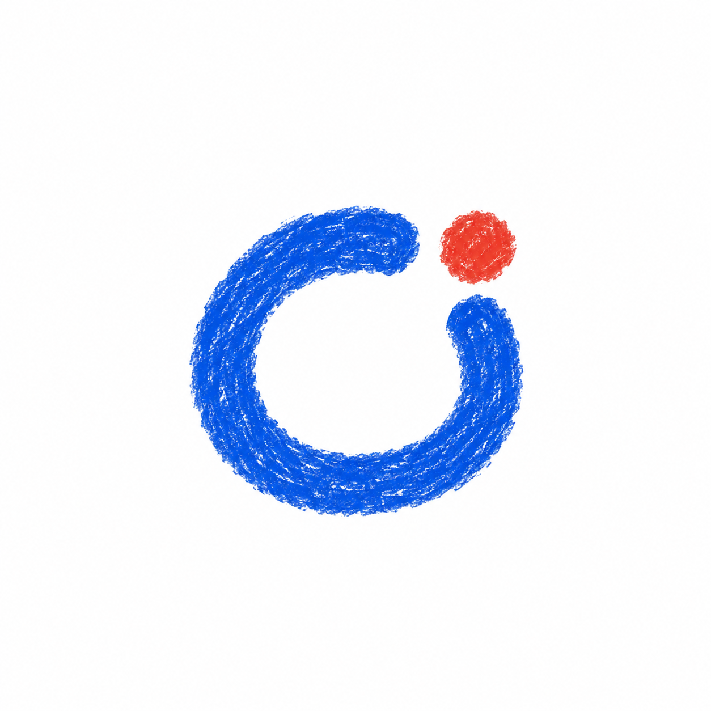
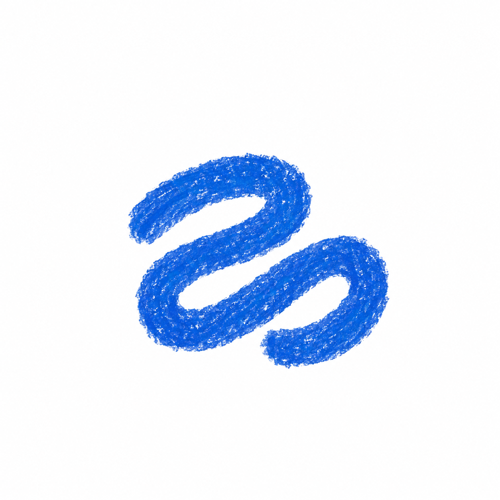
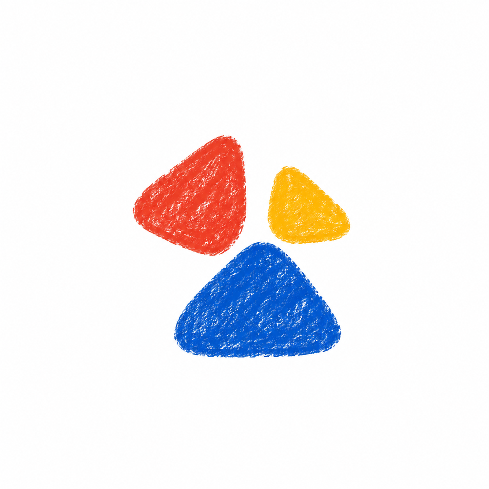
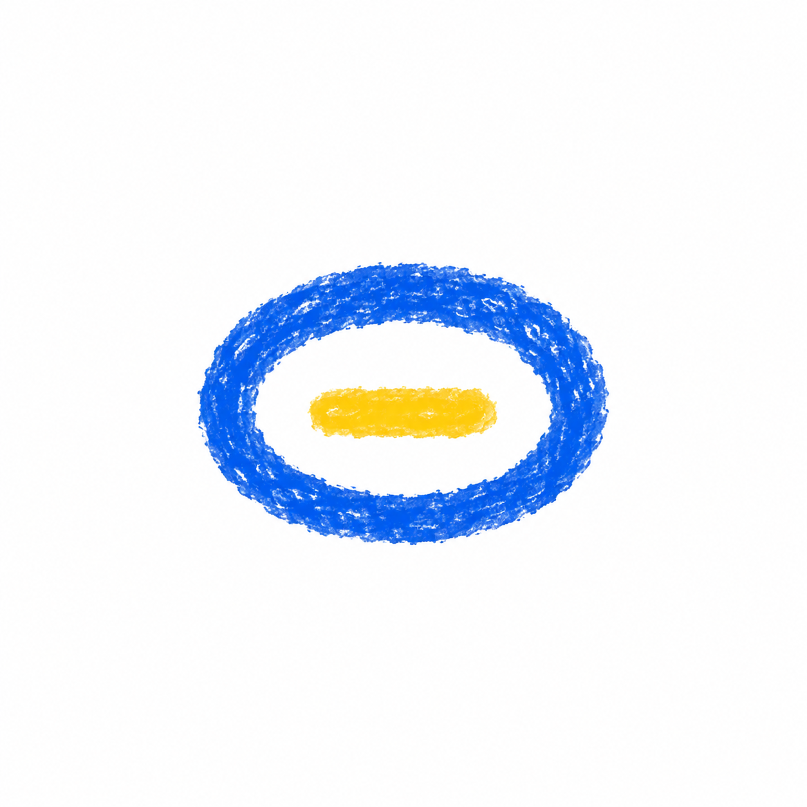
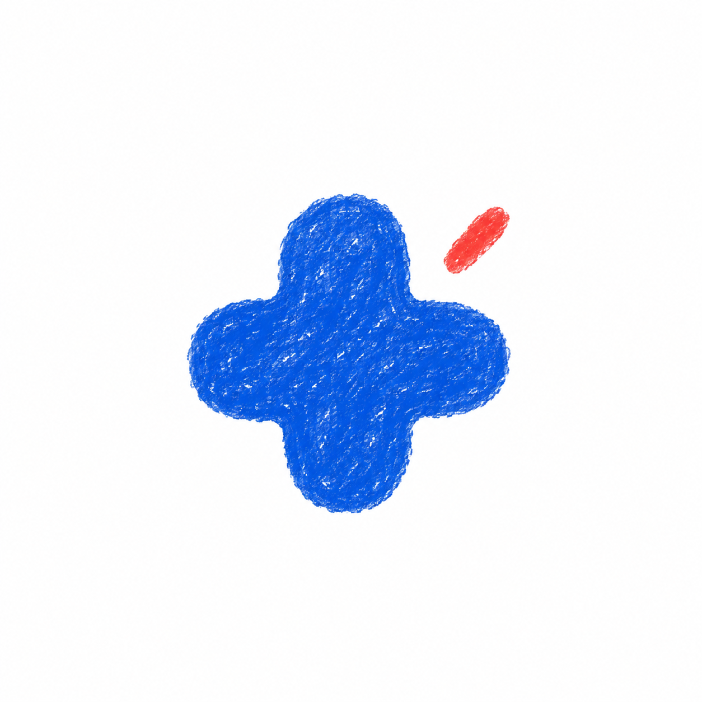

# Chit abstract avatar explorations

Generated with the built-in imagegen tool. Minimal crayon shapes, excluding plants and animals.

## 11-open-loop

### Exact generation prompt

Use case: stylized-concept. Generate one original minimalist abstract avatar concept for Chit, a relaxed voice conversation companion. A single compact centered symbol occupying 40% of a square WHITE background, broad clean white margins. Naive illustrated-diary style with authentic flat wax-crayon / dry oil-pastel texture: short overlapping pigment marks, tiny white paper gaps, softly ragged edges, deliberately imperfect freehand shape. Rich cobalt blue, leaf green, tomato red or warm yellow, using only the colors specified for this concept. Extremely simple and recognizable at small web UI sizes. Calm, friendly, quietly playful. No plants, leaves, flowers, animals, humans, faces, eyes, limbs, lettering, numbers, UI, frames, drop shadows, gradients, lighting effects, glossy or 3D rendering. Preserve flat drawn pigment, not textured sculpture. One thick cobalt-blue crayon loop, almost circular but slightly squashed and asymmetric, with a small opening at upper right and chunky softly rounded ends. The inside is white. One tiny warm red round crayon dot rests just outside that opening, close enough to feel part of the same compact symbol. Like a quiet thought becoming a voice. Two elements only, no concentric rings.

## 12-soft-fold

### Exact generation prompt

Use case: stylized-concept. Generate one original minimalist abstract avatar concept for Chit, a relaxed voice conversation companion. A single compact centered symbol occupying 40% of a square WHITE background, broad clean white margins. Naive illustrated-diary style with authentic flat wax-crayon / dry oil-pastel texture: short overlapping pigment marks, tiny white paper gaps, softly ragged edges, deliberately imperfect freehand shape. Rich cobalt blue, leaf green, tomato red or warm yellow, using only the colors specified for this concept. Extremely simple and recognizable at small web UI sizes. Calm, friendly, quietly playful. No plants, leaves, flowers, animals, humans, faces, eyes, limbs, lettering, numbers, UI, frames, drop shadows, gradients, lighting effects, glossy or 3D rendering. Preserve flat drawn pigment, not textured sculpture. One continuous broad cobalt-blue crayon stroke forming a loose horizontal folded squiggle: two rounded overlapping-looking bends like a very simple relaxed ribbon or a casually drawn lowercase loop, but NOT any actual letter. Keep the whole symbol compact, roughly square. A flat mark on paper with white breathing spaces between folds, no 3D shading or ribbon highlights. One color, one stroke, no extra decorations.

## 13-three-pebbles

### Exact generation prompt

Use case: stylized-concept. Generate one original minimalist abstract avatar concept for Chit, a relaxed voice conversation companion. A single compact centered symbol occupying 40% of a square WHITE background, broad clean white margins. Naive illustrated-diary style with authentic flat wax-crayon / dry oil-pastel texture: short overlapping pigment marks, tiny white paper gaps, softly ragged edges, deliberately imperfect freehand shape. Rich cobalt blue, leaf green, tomato red or warm yellow, using only the colors specified for this concept. Extremely simple and recognizable at small web UI sizes. Calm, friendly, quietly playful. No plants, leaves, flowers, animals, humans, faces, eyes, limbs, lettering, numbers, UI, frames, drop shadows, gradients, lighting effects, glossy or 3D rendering. Preserve flat drawn pigment, not textured sculpture. Exactly three flat abstract soft triangular crayon daubs arranged as a compact loose cluster with small clear white gaps. One larger cobalt blue shape at bottom, one medium warm red shape upper left, one small golden yellow shape upper right. Rounded lopsided corners, simple distinct silhouettes. Composition suggests a friendly little gathering of sounds. No literal rocks, no eyes, no scenery, no shadows.

## 14-hollow-hum

### Exact generation prompt

Use case: stylized-concept. Generate one original minimalist abstract avatar concept for Chit, a relaxed voice conversation companion. A single compact centered symbol occupying 40% of a square WHITE background, broad clean white margins. Naive illustrated-diary style with authentic flat wax-crayon / dry oil-pastel texture: short overlapping pigment marks, tiny white paper gaps, softly ragged edges, deliberately imperfect freehand shape. Rich cobalt blue, leaf green, tomato red or warm yellow, using only the colors specified for this concept. Extremely simple and recognizable at small web UI sizes. Calm, friendly, quietly playful. No plants, leaves, flowers, animals, humans, faces, eyes, limbs, lettering, numbers, UI, frames, drop shadows, gradients, lighting effects, glossy or 3D rendering. Preserve flat drawn pigment, not textured sculpture. One chunky uneven cobalt-blue crayon oval ring, wider than tall, enclosing exactly one short horizontal warm yellow crayon dash floating in the white center. Soft blunt edges throughout. The outer oval has slight asymmetry like a quick hand-drawn doodle. Abstract quiet resonance, two elements only, no eyes or face, no extra rings.

## 15-rounded-spark

### Exact generation prompt

Use case: stylized-concept. Generate one original minimalist abstract avatar concept for Chit, a relaxed voice conversation companion. A single compact centered symbol occupying 40% of a square WHITE background, broad clean white margins. Naive illustrated-diary style with authentic flat wax-crayon / dry oil-pastel texture: short overlapping pigment marks, tiny white paper gaps, softly ragged edges, deliberately imperfect freehand shape. Rich cobalt blue, leaf green, tomato red or warm yellow, using only the colors specified for this concept. Extremely simple and recognizable at small web UI sizes. Calm, friendly, quietly playful. No plants, leaves, flowers, animals, humans, faces, eyes, limbs, lettering, numbers, UI, frames, drop shadows, gradients, lighting effects, glossy or 3D rendering. Preserve flat drawn pigment, not textured sculpture. One solid cobalt-blue abstract four-lobed shape, like a very soft plus sign with short fat rounded lobes and a full rounded center. Slightly uneven and casually hand-drawn, compact and friendly, emphatically NOT a flower: only four broad blunt extensions, no separate petals, no center circle, no stem. One little tomato-red dash nearby at upper right, with a generous white gap. Minimal expressive punctuation-like presence, no face.

