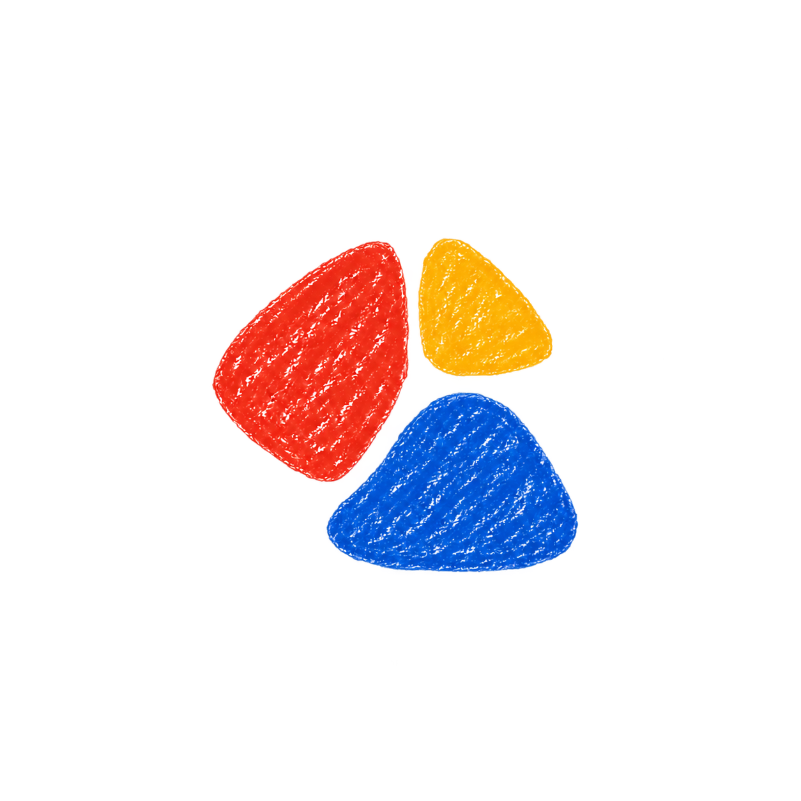
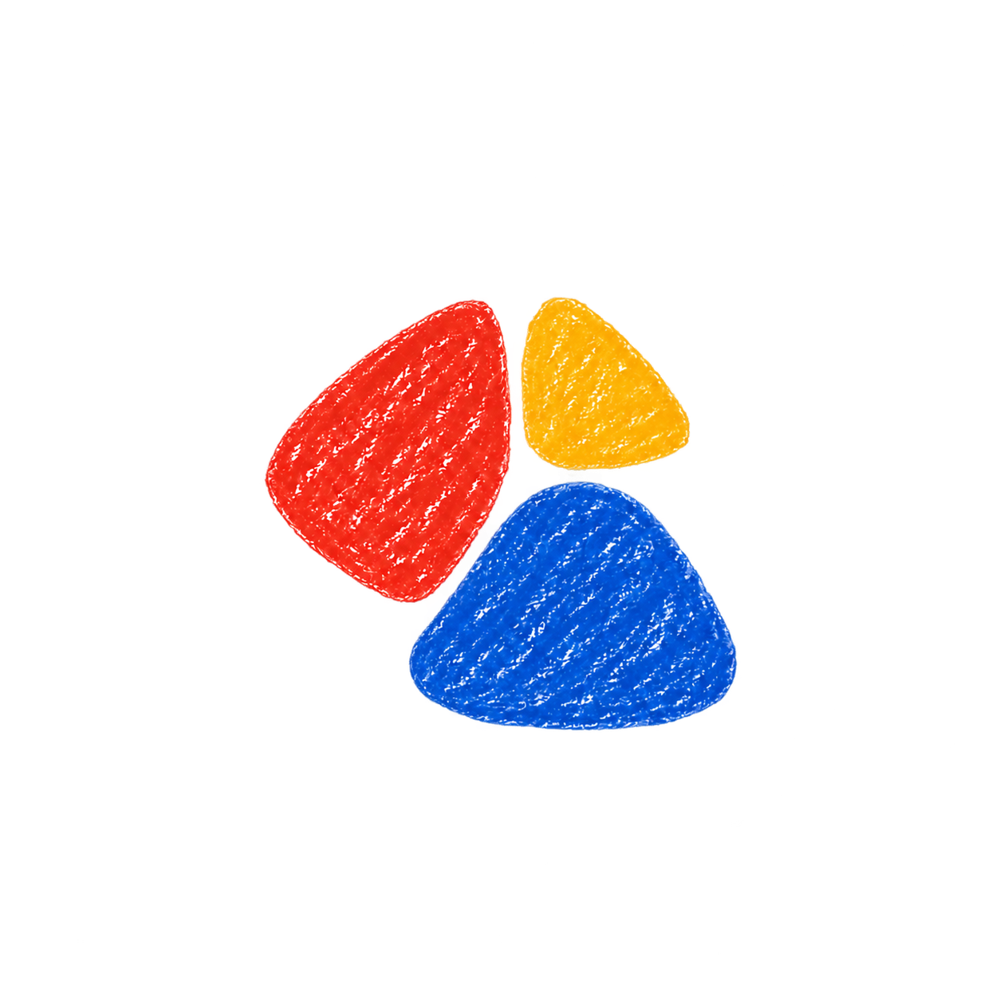
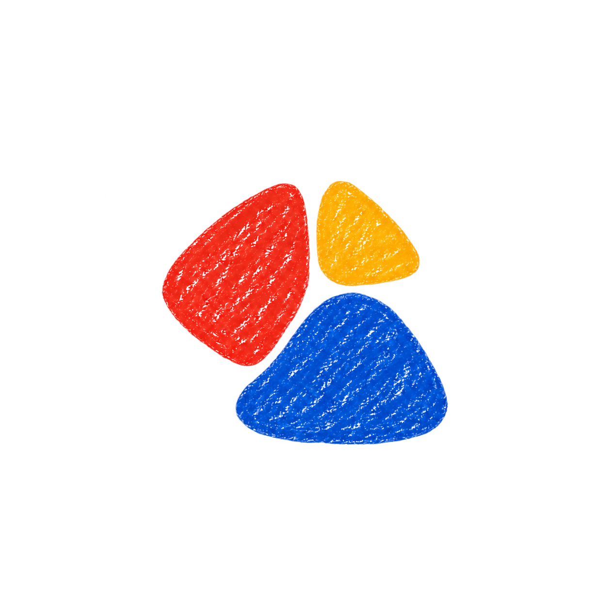

# Chit — subtle pebble refinements

The user selected **00-baseline.png** as the new visual baseline. It is an unchanged copy of the approved image. These ten alternatives keep the same red, yellow, and blue crayon pebble composition and explore very small changes to area, roundness, or spacing.

Generated with the built-in imagegen tool, with every variant edited directly from the approved baseline. The numerical changes in the [exact prompts](prompts.json) describe the intended adjustments; generated results are approximate.

## Baseline

## Variations

### 01 blue slightly smaller

Requested change: Reduce only the blue pebble's filled area by approximately 6 percent by shrinking its width and height about 3 percent around its existing center. Keep its exact silhouette otherwise. Red and yellow completely unchanged.

### 02 blue narrower

Requested change: Make only the blue pebble approximately 4 percent narrower horizontally around its existing center, retaining its original height, rotation and rounded triangular contour. Red and yellow completely unchanged.

### 03 blue lower profile

Requested change: Reduce only the blue pebble's height by approximately 4 percent, keeping its lower edge and width in place. This slightly lowers its upper curved peak. Preserve the blue silhouette's asymmetry. Red and yellow completely unchanged.

### 04 blue left corner trim

Requested change: Very slightly pull in the blue pebble's protruding lower-left corner by about 10 pixels relative to this roughly 1254px image, smoothly blending the tiny adjustment into the adjoining contour. This is a local reduction of the blue area, especially near its left lower portion. Do not add a dent or hole. Keep the blue top, bottom center and right edge fixed. Red and yellow completely unchanged.

### 05 blue softer corners

Requested change: Round only the blue pebble's three corner transitions a little more, trimming their extreme tips by roughly 5 to 8 pixels on this roughly 1254px image. Keep its overall width, height, asymmetry, location and rounded triangular identity as close as possible. Red and yellow completely unchanged.

### 06 all gently rounder

Requested change: Make all three pebbles' corner transitions just a little softer, rounding off only the last 5 to 8 pixels of their tips on this roughly 1254px image. Preserve the three recognizable asymmetrical triangular shapes, the same widths, heights, arrangement and spacing. Very subtle softness, not circular blobs.

### 07 red softened tip

Requested change: Soften only the red pebble's upper narrow corner and its bottom pointed corner by a very small amount, rounding each tip inward approximately 6 pixels on this roughly 1254px image. Keep the red body, placement and asymmetrical triangle identity. Blue and yellow completely unchanged.

### 08 yellow softer

Requested change: Make only the yellow pebble's rightmost corner slightly rounder and less pointy, trimming about 7 pixels off that tip on this roughly 1254px image and smoothly easing its adjacent contour. Preserve the yellow size, placement and triangular identity. Red and blue completely unchanged.

### 09 tiny breathing space

Requested change: Move only the blue pebble downward approximately 7 pixels relative to this roughly 1254px canvas, giving the central meeting point a tiny bit more breathing space. Preserve every shape's size, silhouette, texture, color and rotation. Red and yellow stay exactly in place. Barely perceptible spacing adjustment.

### 10 smaller blue gentle rounding

Requested change: A restrained combination: reduce the blue pebble width and height by only 2 percent around its existing center, and soften the extreme tips of all three pebbles by about 4 pixels on this roughly 1254px image. Keep the original triangular identities, composition and texture. This should look almost identical to the approved baseline, merely slightly less bulky and slightly gentler.

