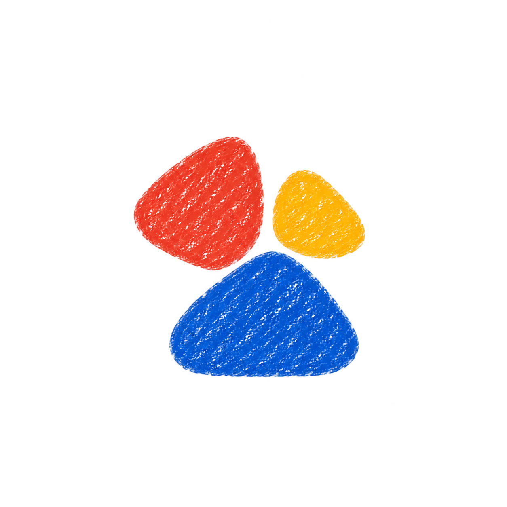
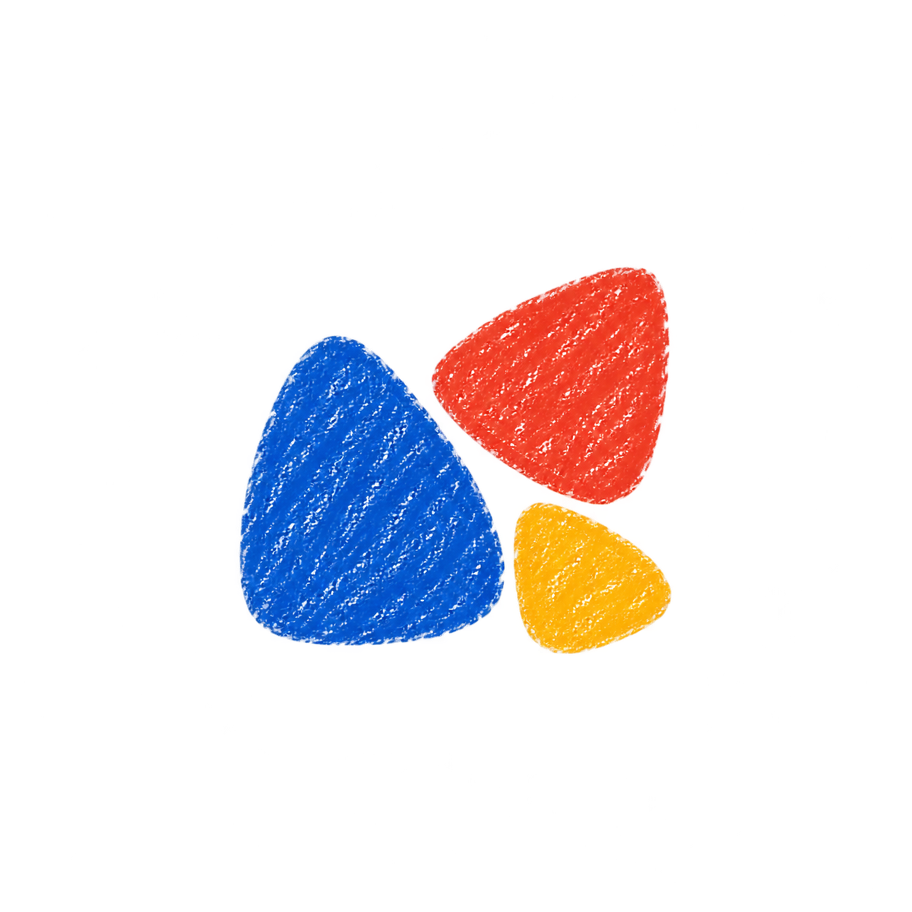
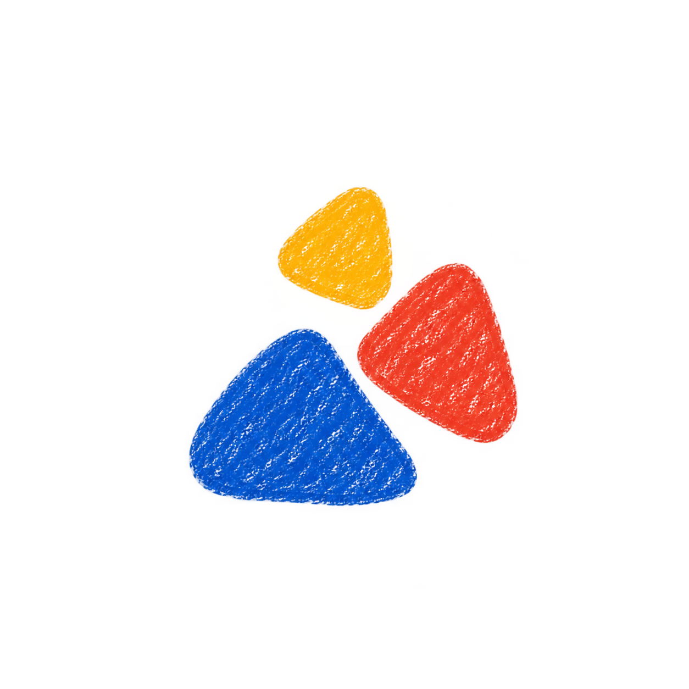
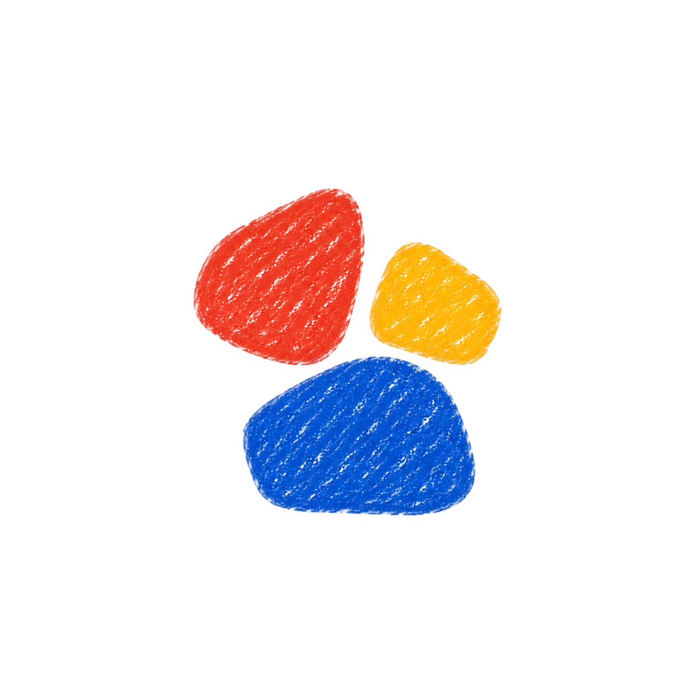

# Chit pebble variations

Generated with built-in imagegen using the selected three-pebble image as a visual reference.

## 16-pebbles-soft-trio

### Exact generation prompt

Create one new closely related variation of the attached Chit avatar. Input image role: visual style and shape-family reference, not a scene to reproduce exactly. Preserve its authentic wax-crayon scribbles, tiny white paper gaps in dense pigment, ragged soft edges, vivid cobalt blue / tomato red / golden yellow palette, flat naive illustrated-diary feel. Exactly THREE separate solid abstract shapes with clear white gaps, arranged into ONE compact centered avatar on a square white paper canvas with generous margins. Rounded lopsided pebble-like geometry, extremely minimal, same chunky weight and texture as reference. No faces, eyes, plants, animals, letters, captions, outlines, shadows, gradients, glossy finish, 3D, frames or extra decorative marks. Keep approximately the same overall scale as reference. Stay especially close to the reference: large blue rounded triangular pebble at bottom, medium red rounded triangular pebble upper left, small yellow rounded triangular pebble upper right. Make all three a little plumper, more curved, less pointed. Cozy asymmetric cluster, relaxed narrow white gaps.

## 17-pebbles-sideways

### Exact generation prompt

Create one new closely related variation of the attached Chit avatar. Input image role: visual style and shape-family reference, not a scene to reproduce exactly. Preserve its authentic wax-crayon scribbles, tiny white paper gaps in dense pigment, ragged soft edges, vivid cobalt blue / tomato red / golden yellow palette, flat naive illustrated-diary feel. Exactly THREE separate solid abstract shapes with clear white gaps, arranged into ONE compact centered avatar on a square white paper canvas with generous margins. Rounded lopsided pebble-like geometry, extremely minimal, same chunky weight and texture as reference. No faces, eyes, plants, animals, letters, captions, outlines, shadows, gradients, glossy finish, 3D, frames or extra decorative marks. Keep approximately the same overall scale as reference. Rearrange into a compact sideways cluster: largest blue soft triangular pebble on left, medium red pebble upper right, smallest golden-yellow pebble lower right. The shapes gently turn toward a small white central gap. Smoothly rounded irregular corners, friendly asymmetry.

## 18-pebbles-tumbling

### Exact generation prompt

Create one new closely related variation of the attached Chit avatar. Input image role: visual style and shape-family reference, not a scene to reproduce exactly. Preserve its authentic wax-crayon scribbles, tiny white paper gaps in dense pigment, ragged soft edges, vivid cobalt blue / tomato red / golden yellow palette, flat naive illustrated-diary feel. Exactly THREE separate solid abstract shapes with clear white gaps, arranged into ONE compact centered avatar on a square white paper canvas with generous margins. Rounded lopsided pebble-like geometry, extremely minimal, same chunky weight and texture as reference. No faces, eyes, plants, animals, letters, captions, outlines, shadows, gradients, glossy finish, 3D, frames or extra decorative marks. Keep approximately the same overall scale as reference. Three rounded triangular crayon pebbles in a playful diagonal rising arrangement: largest blue lower left, medium red near center-right, small yellow above near center. Keep compact like a little tumbling trio, not widely spaced. Each has its own gentle rotation, with full silhouettes visible and no overlap.

## 19-pebbles-soft-squares

### Exact generation prompt

Create one new closely related variation of the attached Chit avatar. Input image role: visual style and shape-family reference, not a scene to reproduce exactly. Preserve its authentic wax-crayon scribbles, tiny white paper gaps in dense pigment, ragged soft edges, vivid cobalt blue / tomato red / golden yellow palette, flat naive illustrated-diary feel. Exactly THREE separate solid abstract shapes with clear white gaps, arranged into ONE compact centered avatar on a square white paper canvas with generous margins. Rounded lopsided pebble-like geometry, extremely minimal, same chunky weight and texture as reference. No faces, eyes, plants, animals, letters, captions, outlines, shadows, gradients, glossy finish, 3D, frames or extra decorative marks. Keep approximately the same overall scale as reference. A very close material and palette variation, but use three soft lopsided rounded quadrilateral pebbles rather than triangles. Largest cobalt-blue pebble below, tomato-red pebble upper left, small golden-yellow pebble upper right. Hand-formed pillow-like flat shapes, not regular geometric squares or app icons; no dimensional shading.

## 20-pebbles-orbit

### Exact generation prompt

Create one new closely related variation of the attached Chit avatar. Input image role: visual style and shape-family reference, not a scene to reproduce exactly. Preserve its authentic wax-crayon scribbles, tiny white paper gaps in dense pigment, ragged soft edges, vivid cobalt blue / tomato red / golden yellow palette, flat naive illustrated-diary feel. Exactly THREE separate solid abstract shapes with clear white gaps, arranged into ONE compact centered avatar on a square white paper canvas with generous margins. Rounded lopsided pebble-like geometry, extremely minimal, same chunky weight and texture as reference. No faces, eyes, plants, animals, letters, captions, outlines, shadows, gradients, glossy finish, 3D, frames or extra decorative marks. Keep approximately the same overall scale as reference. Exactly three plump rounded asymmetrical triangular crayon pebbles gathered around a tiny triangular white central breathing space. Blue biggest lower right, red medium left, yellow smallest upper right. Each curves slightly inward toward the center, rounded outer silhouette, balanced compact gathering. Keep separate and chunky, no spiral strokes, no flower resemblance.

