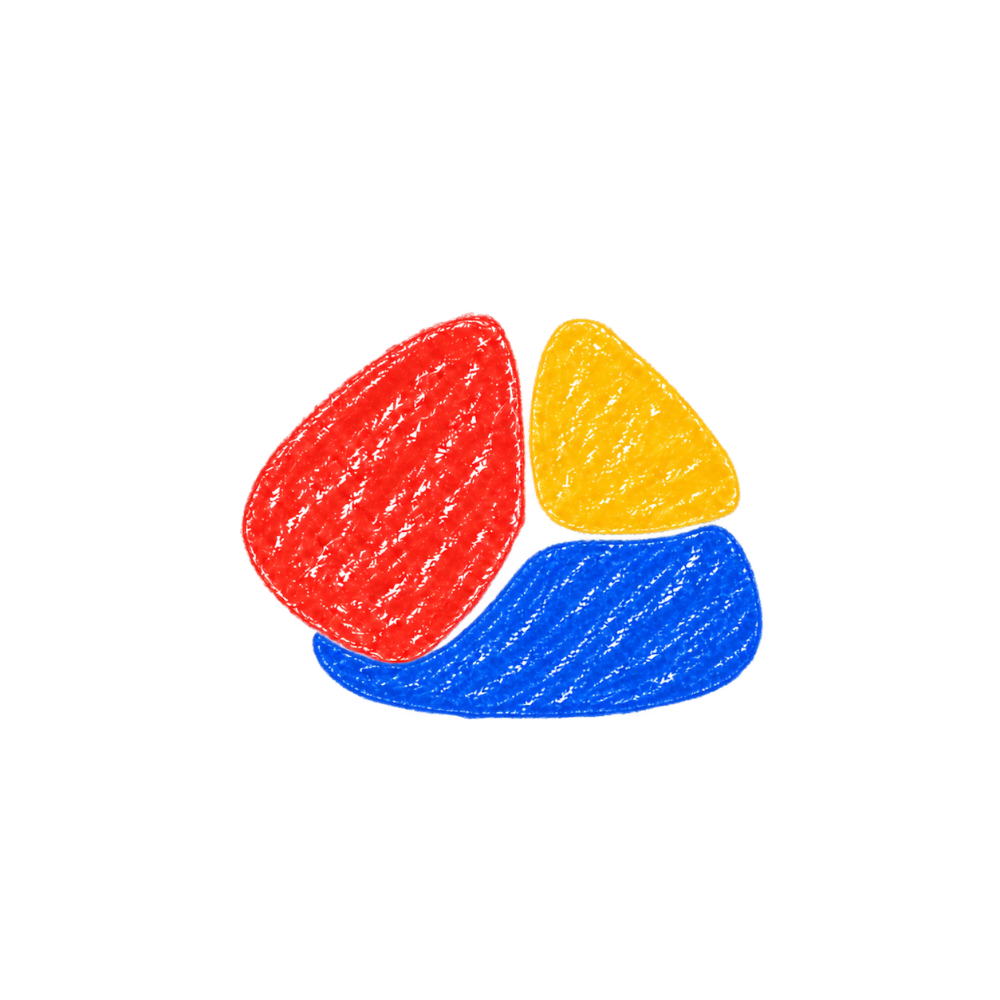

# Chit — a more unified silhouette

Four imagegen explorations that reshape the lower blue piece to complete a compact overall shape with the red and yellow pieces. These are alternatives for review; the previously approved baseline remains preserved.

The design direction relates to [Gestalt closure](https://www.nngroup.com/articles/principle-closure/): separated visual elements can imply a complete form. The user’s thin red loop was treated as an annotation, not artwork.

Generated with built-in imagegen. [Exact prompts](prompts.json).

## 01 compact pebble

Requested direction: Make the three colored fragments together read as one compact, softly rounded irregular triangular pebble. The blue becomes a shallower rounded lower-right wedge whose outer bottom curve gently continues the curve suggested by the red left edge and yellow right edge. Give the whole mark a stable, coherent footprint and eliminate the dangling low blue point. Match the existing organic shapes very closely.

## 02 soft oval

Requested direction: Aim for one slightly wide, tilted oval-like overall mass suggested by the outer edges of all three pieces. The blue becomes a low curved segment nestled at bottom right, with a gently curved bottom and a softly bulging right edge continuing from the yellow. Pull blue's lower edge up considerably; no huge blue base below the red. Do not force a perfect oval or modify the red and yellow to achieve symmetry.

## 03 rounded lozenge

Requested direction: Aim for one soft, lopsided rounded diamond / lozenge silhouette for the three-piece cluster. Keep the existing upper red and yellow geometry. The blue is a compact broad-bottom wedge with only a very shallow rounded lower point, rather than a tall standalone triangle. Its lower-left edge visually joins the red's lower edge across a tiny gap and its right edge continues from yellow. Maintain very soft corners.

## 04 cupped base

Requested direction: Make the existing red and yellow feel cradled by a shallow, solid blue curved base. Reshape blue into a short broad curved wedge with a slightly concave inner top-left edge fitting the red and a short gently rising right shoulder under yellow. Preserve narrow gaps. The outside edges of the three pieces together should suggest one squat rounded pebble or imperfect rounded square. Blue is one substantial filled piece, not an outline, smile, ring, thin crescent or bowl illustration.

## Additional silhouette studies

[View variations 05–14 and their exact prompts](./round-02.md). These continue the cupped-base direction with minor changes to the blue lower piece.

## Close variations of the selected low-base shape

[View variations 15–24 and their exact prompts](./round-03.md). These use the newly supplied reference and focus on minor changes to curves, width and spacing.
