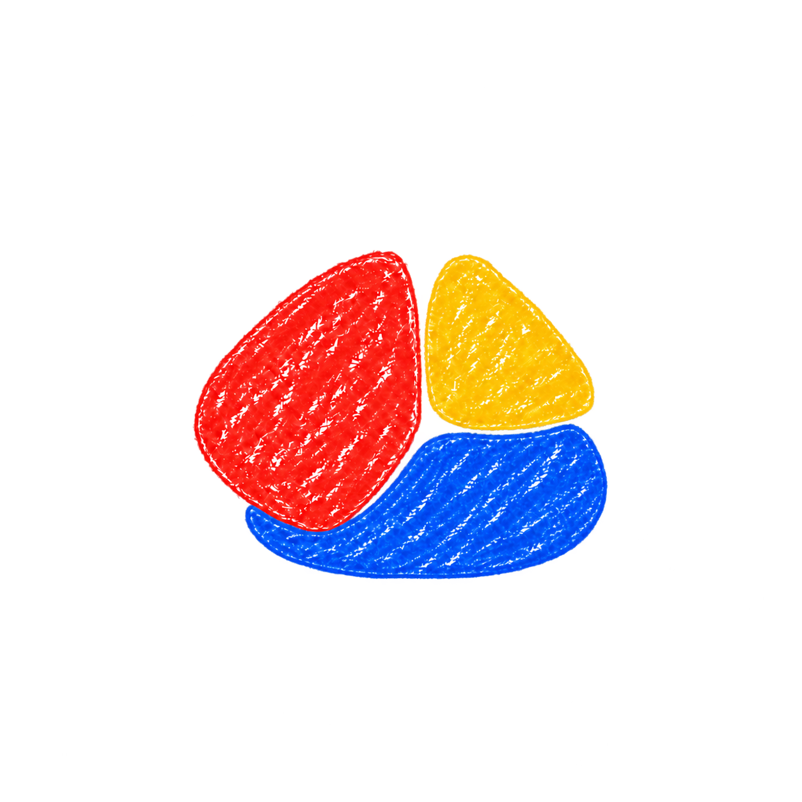
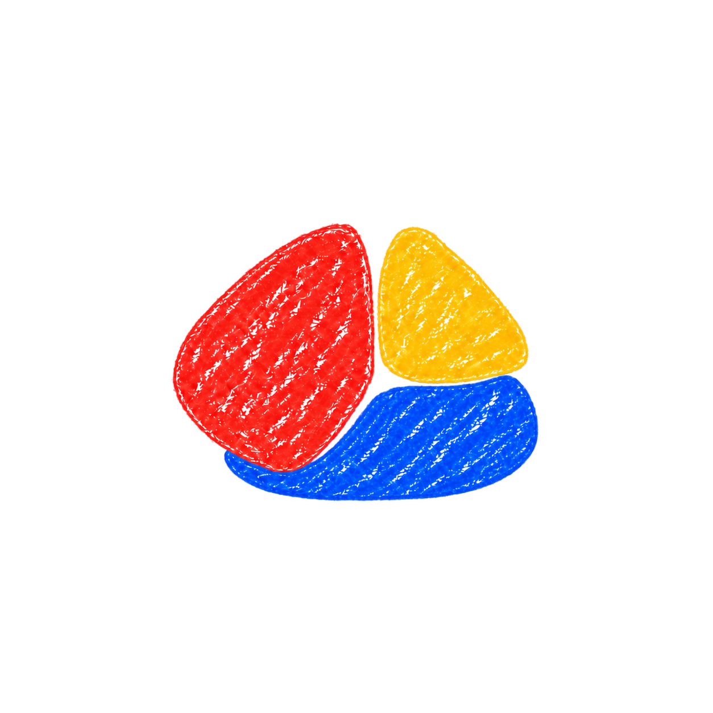
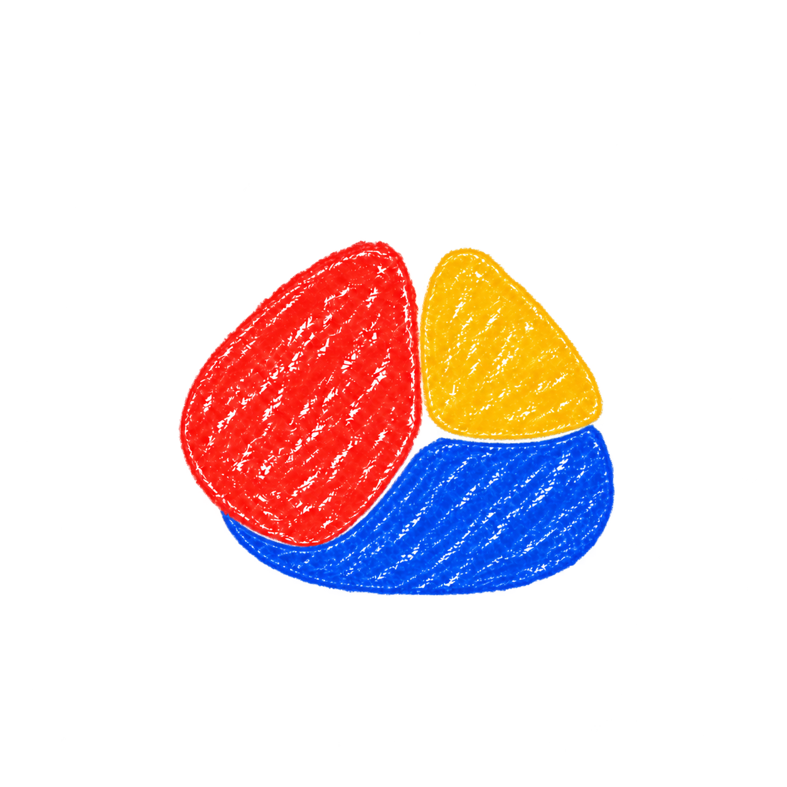
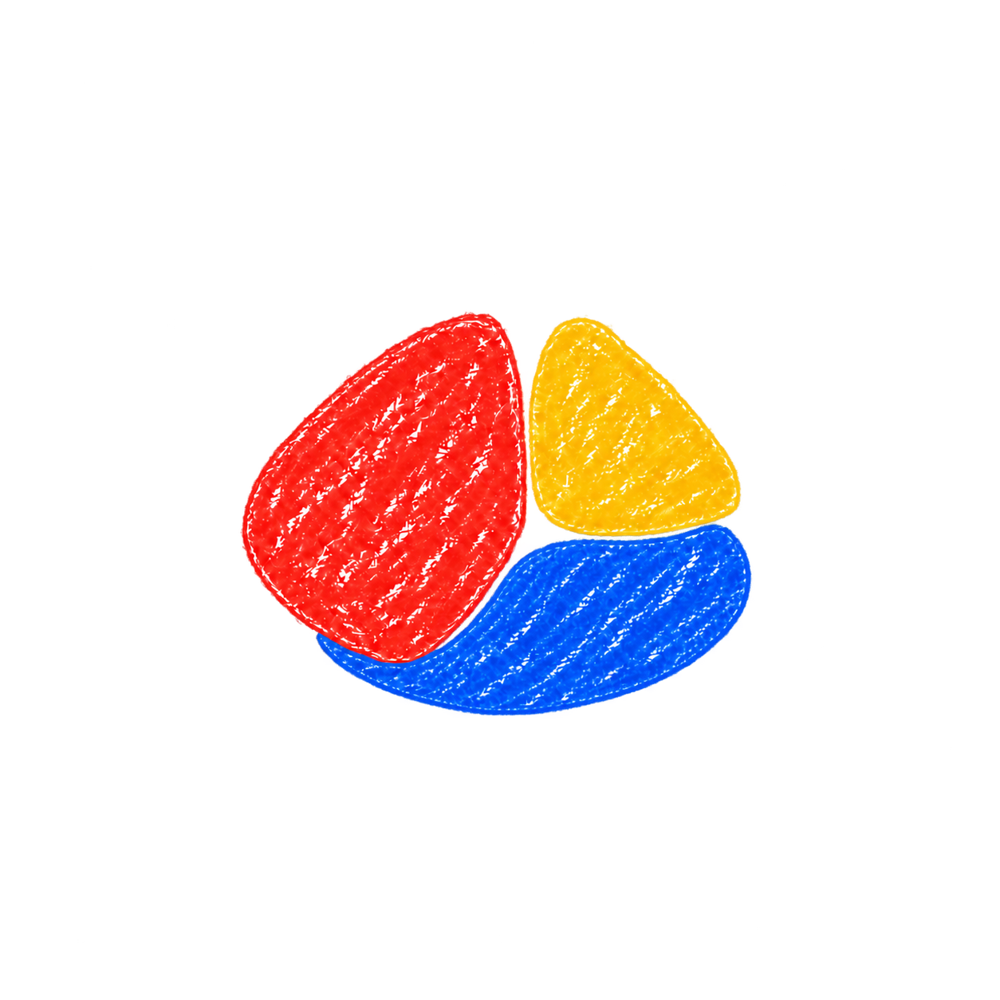
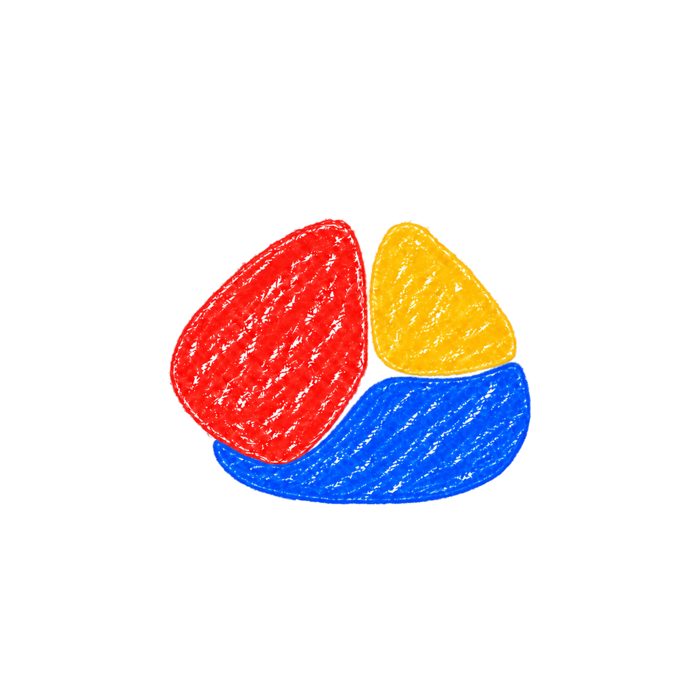
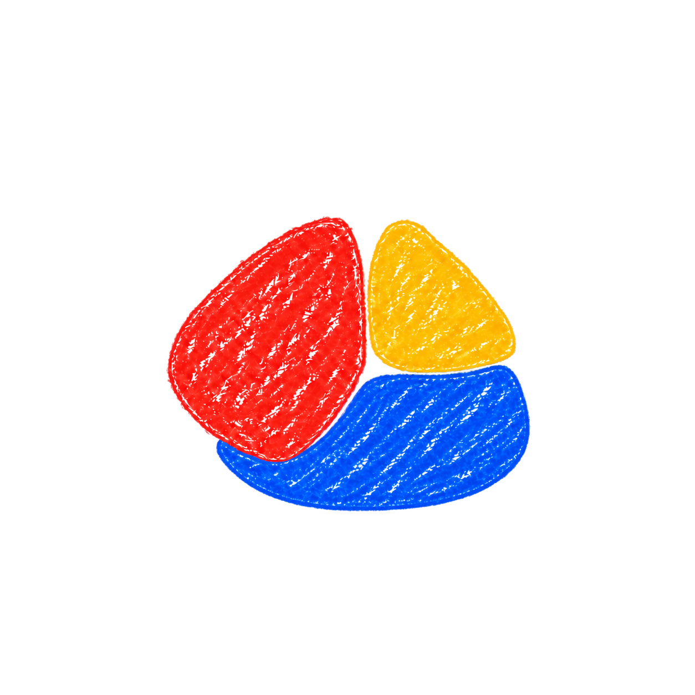
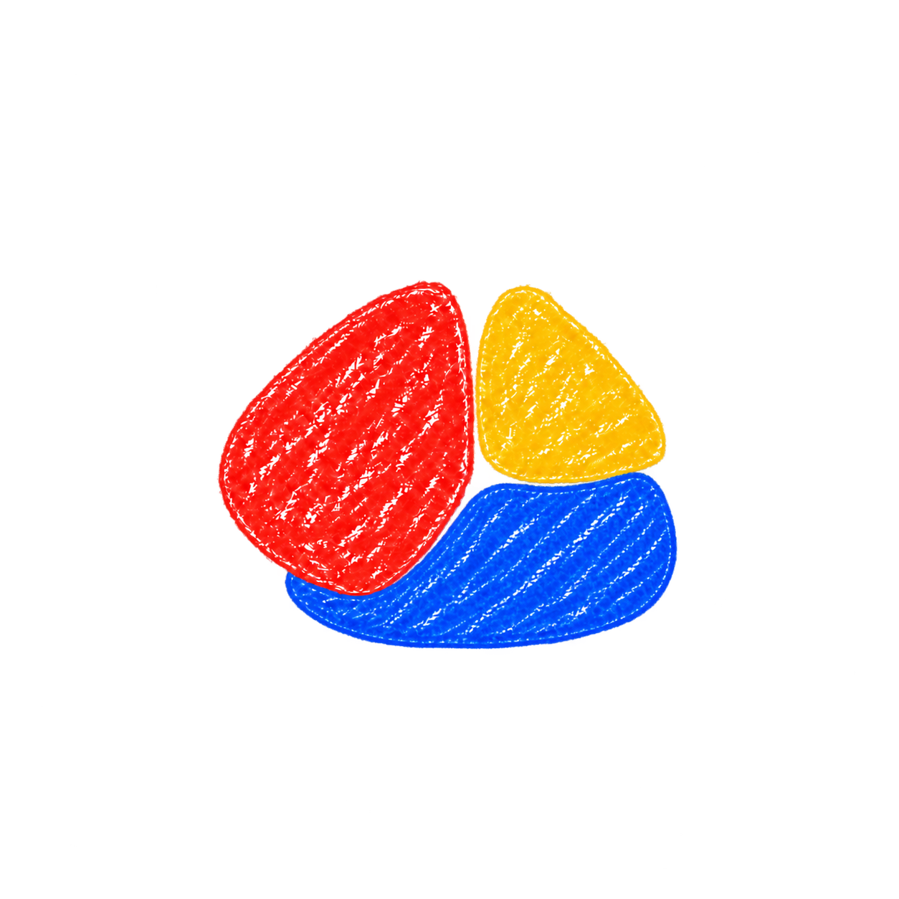
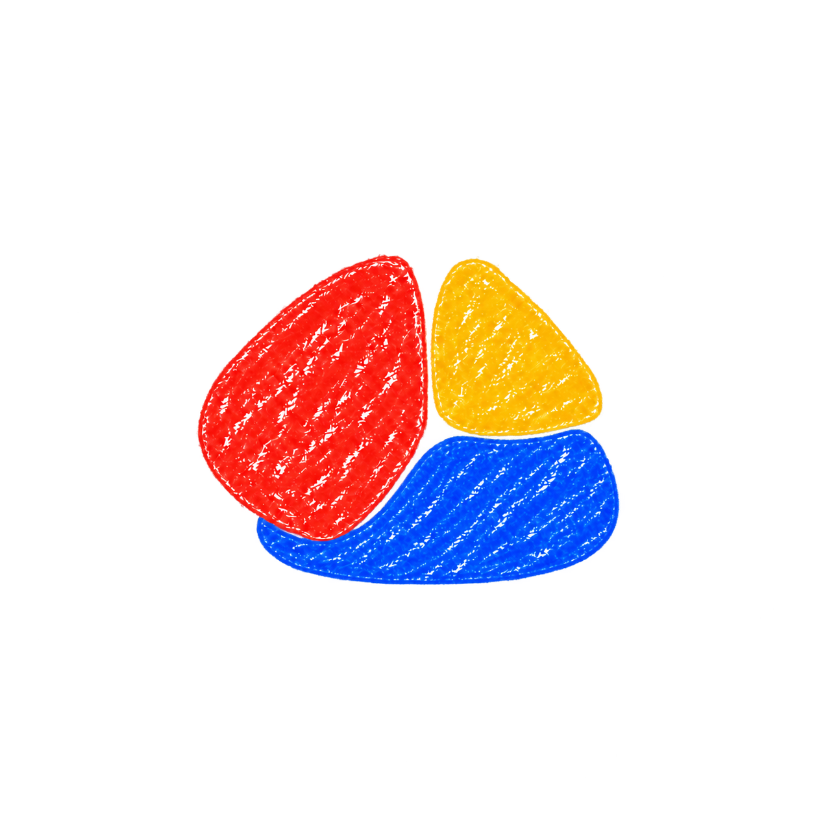

# Chit silhouette refinements: 10 more variations

Variations 05–14 explore subtle changes to the blue base so the three crayon pieces suggest one compact overall shape. These are alternatives for review; the previously approved baseline remains unchanged.

Generated with built-in imagegen in edit mode, using [04 — cupped base](./04-cupped-base.png) as the reference. [Exact prompts and generation details](./prompts-round-02.json).

## 05 rounder envelope

Gently round the blue outer bottom-left and bottom-right corners so the three-piece cluster has a softer oval-like overall envelope. Keep the upper inward curve snug beneath red. The bottom remains fairly shallow. A small, natural refinement of the target.

## 06 soft flat base

Give blue a slightly flatter central bottom edge with large irregular rounded corners, making the whole cluster feel like a softly rounded trapezoid or rounded square. Keep its top edge tucked beneath red and yellow, no increase in overall height, no rigid straight lines.

## 07 shallower cradle

Reduce blue's height about 10 percent by lifting its bottom contour, while keeping its upper fit beneath red and yellow unchanged. Preserve a substantial blue segment, not a thin crescent. The cluster should feel shorter, lighter and more unified.

## 08 left curve continuity

Refine blue's left end so its outside curve visually continues the lower-left curve of red across a narrow gap. Trim the small protruding blue lip under red and smooth the transition into the bottom. Make the entire left-to-bottom sweep feel like one coherent irregular pebble.

## 09 rounded diamond base

Give blue a very shallow, broad rounded low point near the center of its bottom, tapering gently upward toward its left and right ends. The combined shape should suggest a softly rounded lopsided diamond. Keep the blue low point restrained and close to the target footprint, not a hanging triangle.

## 10 right curve continuity

Refine blue's right shoulder so it follows the outward curve suggested by yellow above, then turns smoothly into the base. Pull in any blue rightward overhang a little. Aim for a continuous imaginary right edge from yellow to blue, with a slim transparent seam between them.

## 11 snug egg shape

Make blue's bottom a slightly deeper but softly rounded asymmetric arc, only about 3 percent deeper than the target. Its right edge tucks inward. The whole three-piece mark should suggest a compact egg-like pebble leaning gently left, never a literal egg illustration. Keep upper pieces unchanged.

## 12 gentle left weight

Shift the fullest part of blue's bottom contour slightly leftward under the red-yellow meeting point, and trim its far-right fullness slightly. Preserve blue's top fit and approximate area. The combined mark should feel more centrally balanced and compact, with a subtle asymmetric rounded-triangle silhouette.

## 13 clean fitting seams

Keep the reference's blue outside contour almost unchanged. Adjust only its inner top-left concavity and top-right shoulder so narrow, even transparent seams clearly separate it from both upper pieces. Make the three forms fit like soft hand-drawn puzzle fragments in one compact silhouette. No touching or overlapping, no large central hole.

## 14 compact rounded wedge

Make blue slightly smaller in area, about 5 percent, and soften both outer ends. Shape it as a broad, low curved wedge fitted beneath the two upper pieces, with a softly rising right side and modest concave top-left. Preserve the enclosing overall silhouette while making the blue feel a little less bulky.

