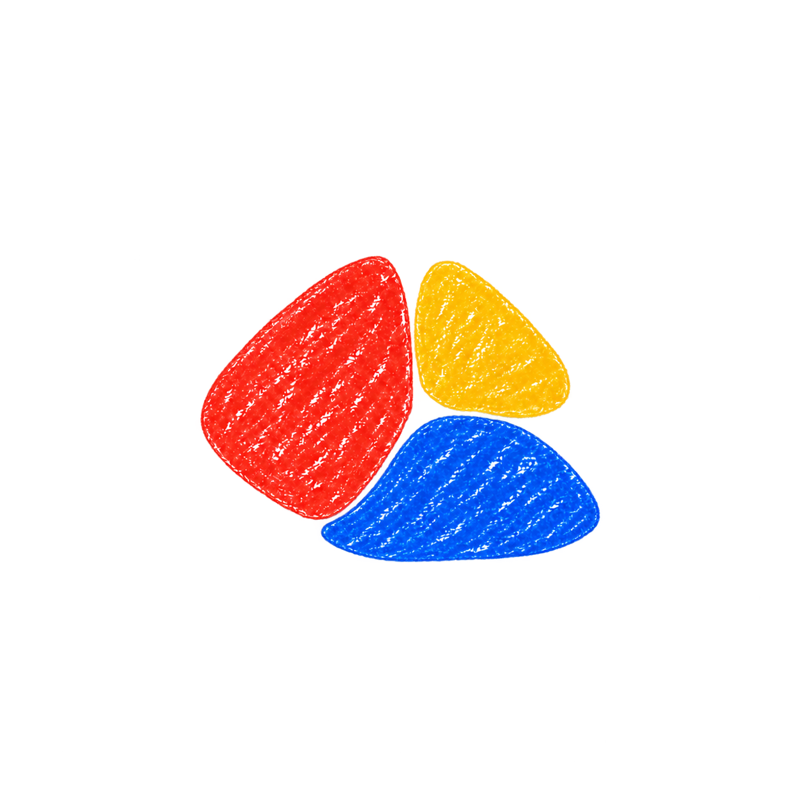
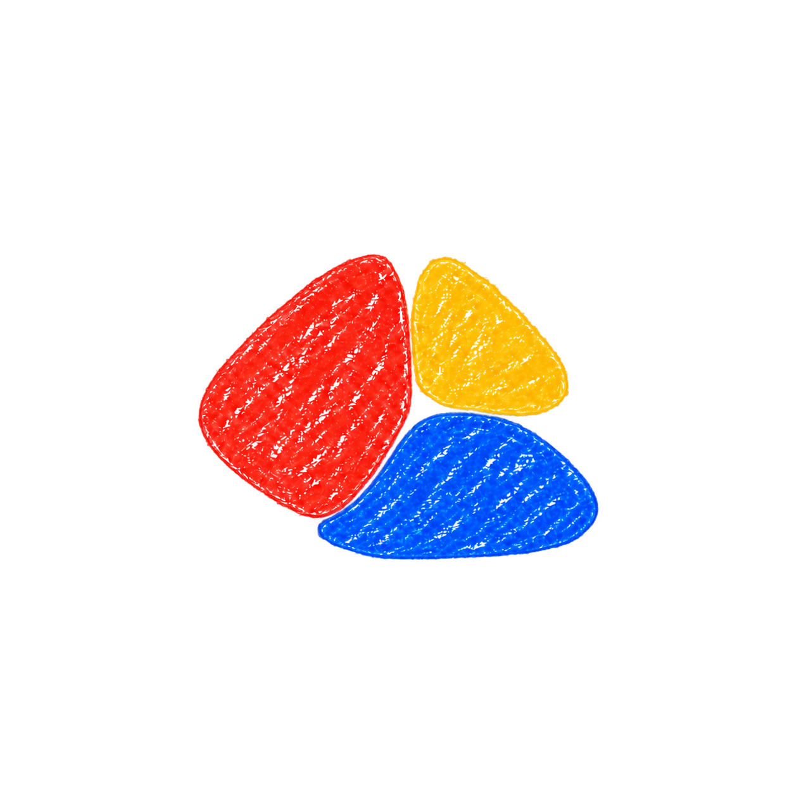
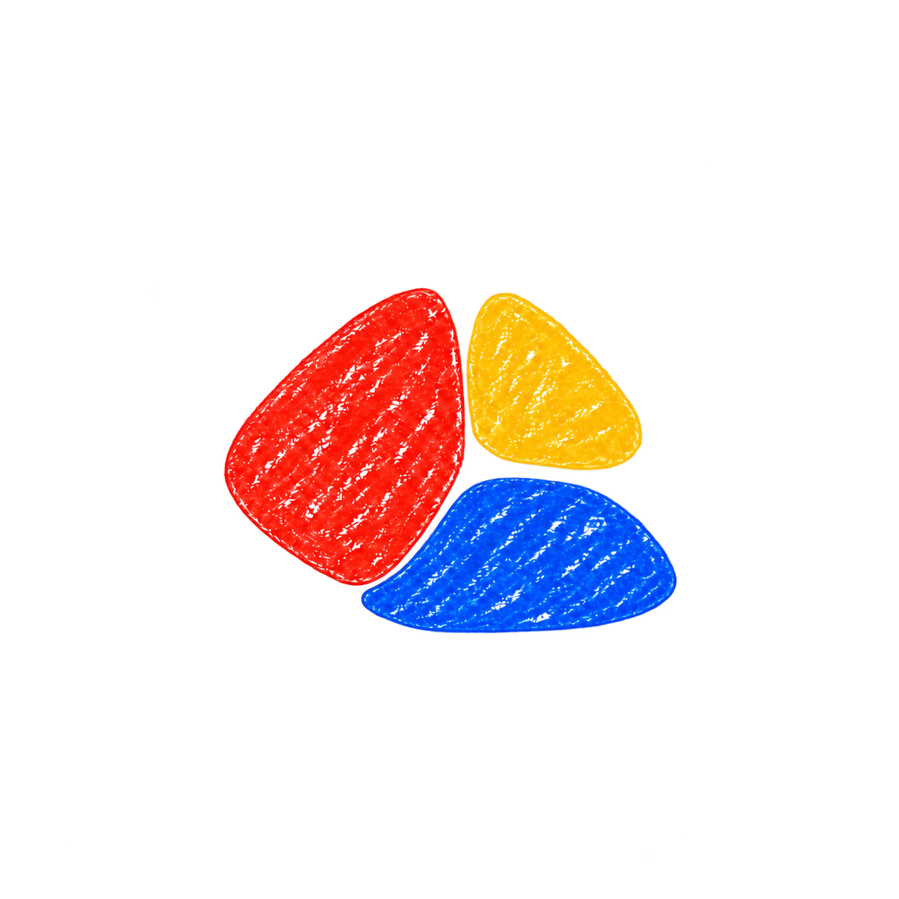
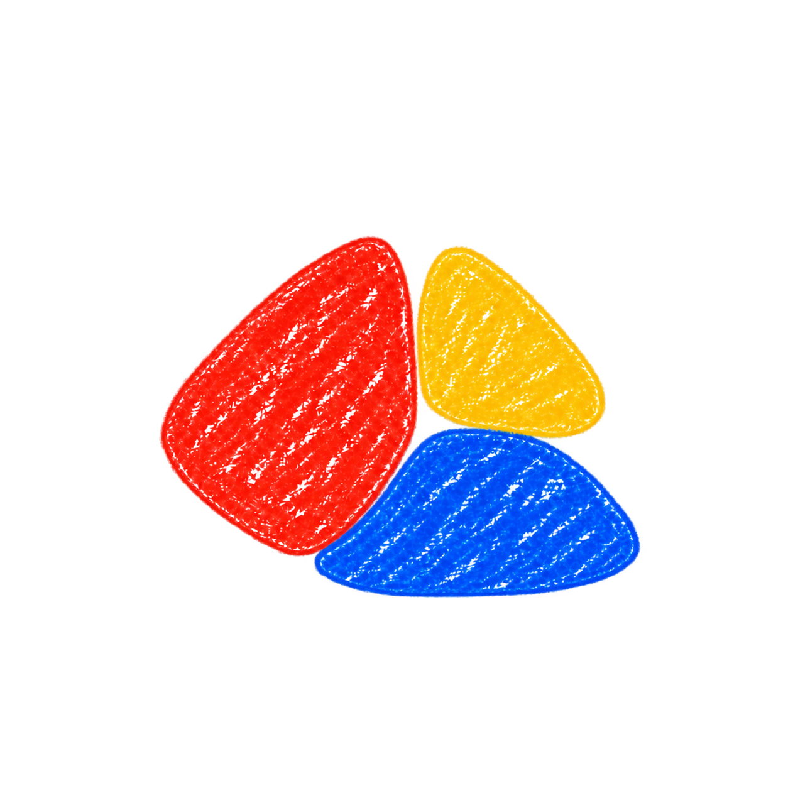
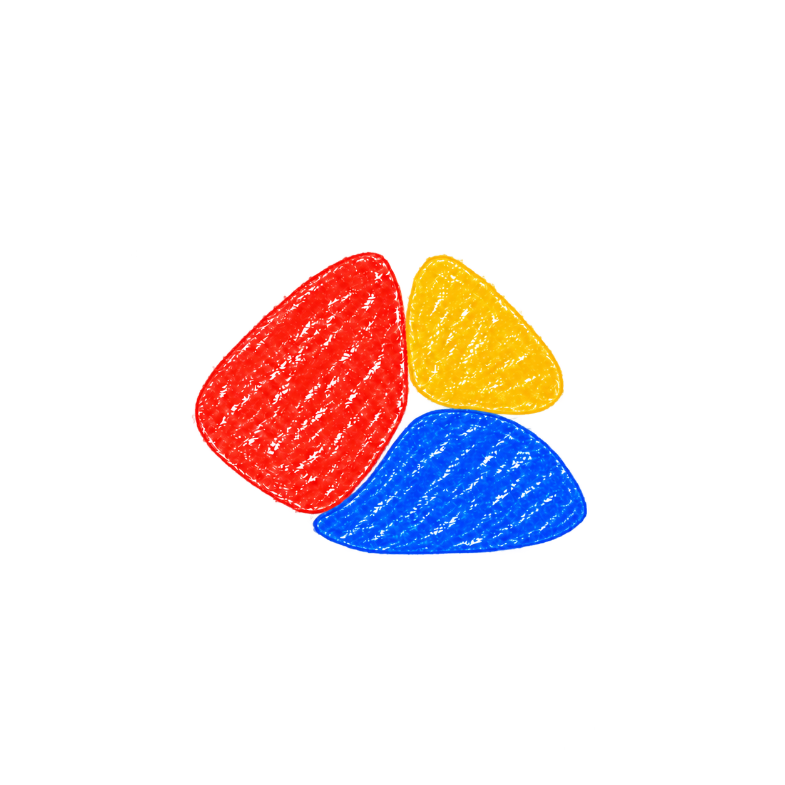
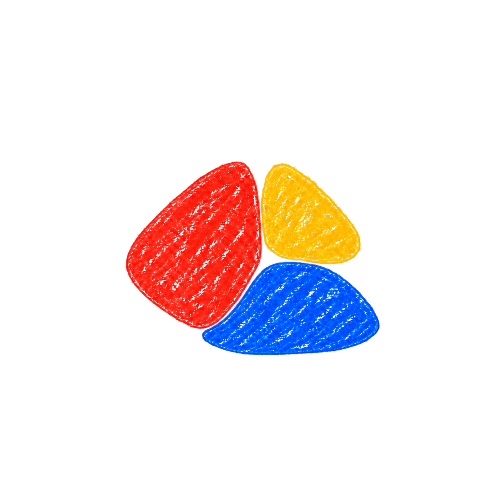
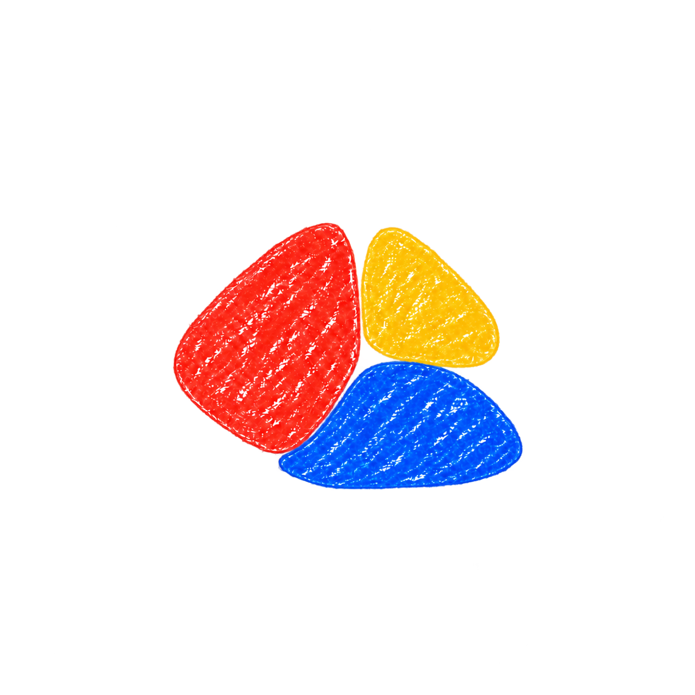
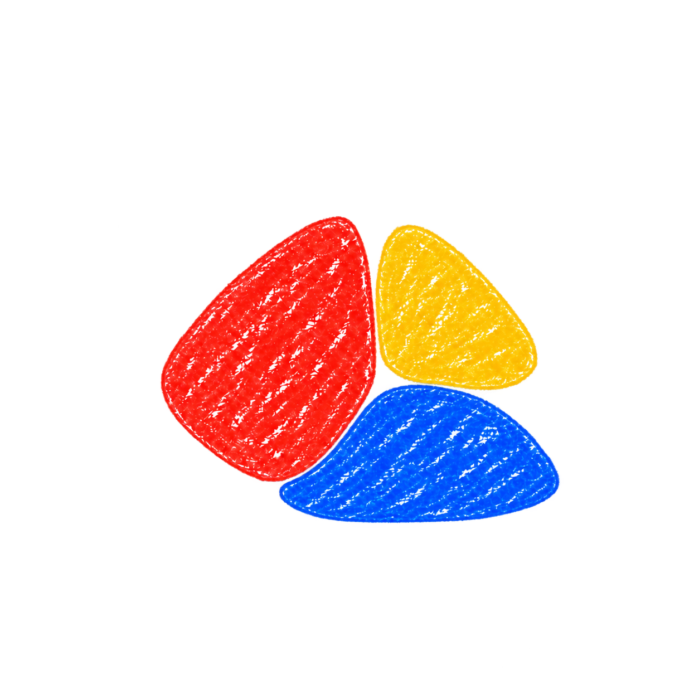
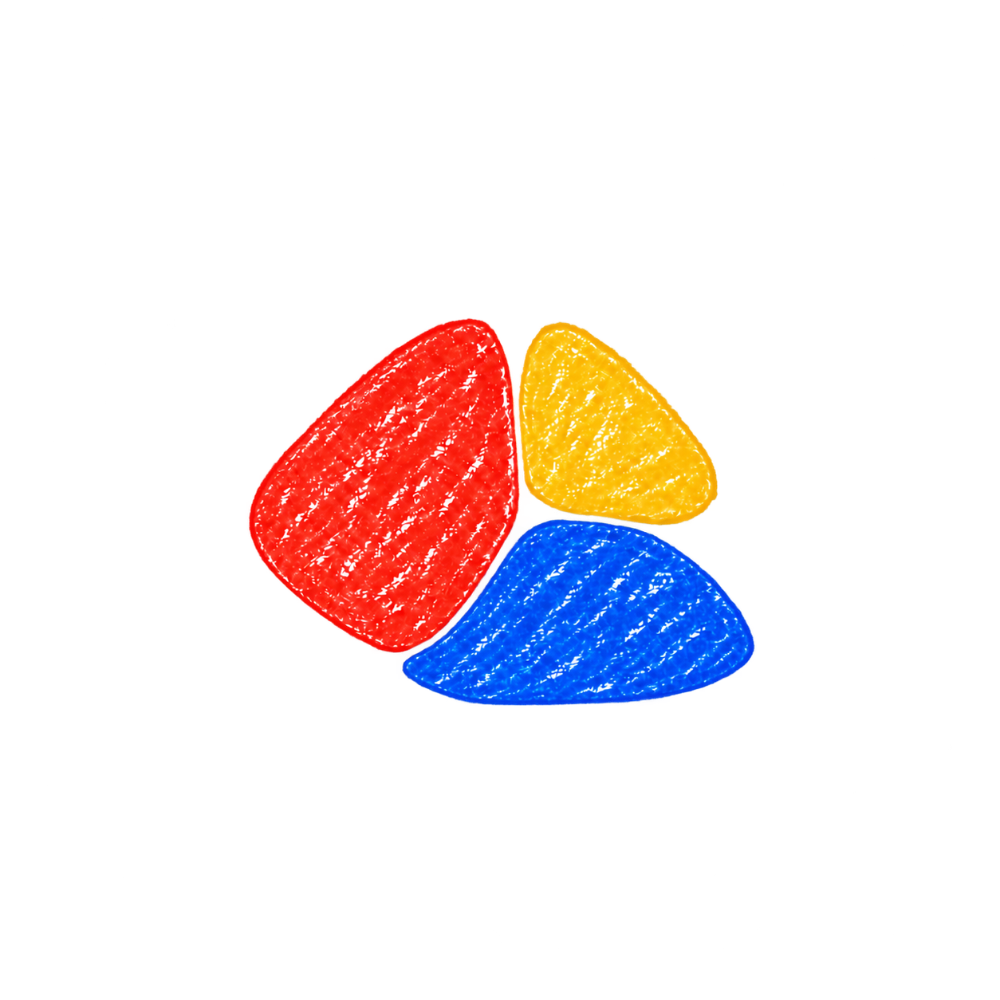
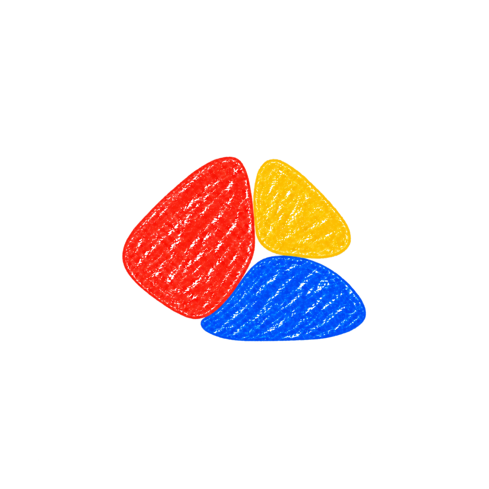

# Chit: close variations of the selected low-base shape

Ten variations, numbered 15–24, generated from the newly supplied reference. The broad red wedge, small yellow top and low blue base remain the visual direction.

Mode: built-in imagegen, using the supplied image as an edit target. The descriptions below record the intended adjustment for each generation; percentage changes in the prompts are approximate creative directions.

[Exact prompts and generation details](./prompts-round-03.json).

## Selected reference

## 15 — Blue softer right end

Intended adjustment: Soften only the blue piece's far-right tip into a slightly rounder end. Keep its low height, broad bottom and upper arch essentially unchanged. All other geometry stays very close to the reference.

## 16 — Blue gentler crown

Intended adjustment: Flatten the highest part of blue's upper arch just slightly, making the blue crown 4–6% lower while its bottom stays at the same level. Keep a tiny clean gap below yellow, and preserve the red and yellow.

## 17 — Blue left cup

Intended adjustment: Lift and round the blue's small left tip a little so it gently follows the red's lower-right edge. Keep the blue very low and wide; this is a subtle fitting adjustment, not a large crescent or bowl.

## 18 — Blue less wide

Intended adjustment: Shorten the blue piece's far-right reach by about 5% of its own width, keeping its left placement and low profile. This brings the overall right edge a little closer beneath yellow. Keep red and yellow unchanged.

## 19 — Rounder lower contour

Intended adjustment: Make the blue piece's bottom contour a very shallow soft arc instead of its almost straight base. Keep the depth change tiny and the overall avatar broad and compact. Preserve the red and yellow.

## 20 — Yellow softer corner

Intended adjustment: Keep the blue and red very close to the target. Gently round only yellow's far-right corner and top tip, keeping yellow visibly wedge-like, the same approximate area, and in the same place.

## 21 — Red softer bottom

Intended adjustment: Keep yellow and blue very close to the target. Round red's bottom tip slightly and shorten that tip a tiny amount to give the narrow red-blue seam a calmer curve. Retain the broad asymmetric red wedge and its dominant size.

## 22 — Tiny even gaps

Intended adjustment: Preserve all three original silhouettes nearly exactly. Introduce only a fine, more even transparent gap at the red-yellow seam and beneath yellow, adjusting placement by just a few pixels in visual terms. Keep the cluster tightly grouped, not separated into floating objects.

## 23 — Blue fuller left half

Intended adjustment: Very subtly shift the visual fullness of the low blue piece leftward beneath red, shaving a little from blue's right tip and adding a tiny amount along its lower-left curve. Keep the same approximate blue area and height; red and yellow stay unchanged.

## 24 — Gently rounded family

Intended adjustment: Apply the smallest coherent rounding pass to the three existing wedges: just soften their tips a little, with blue about 3% shallower. The result must remain an almost identical three-piece mark, with red dominant and the blue low and broad. No circles, no major shape or spacing changes.

