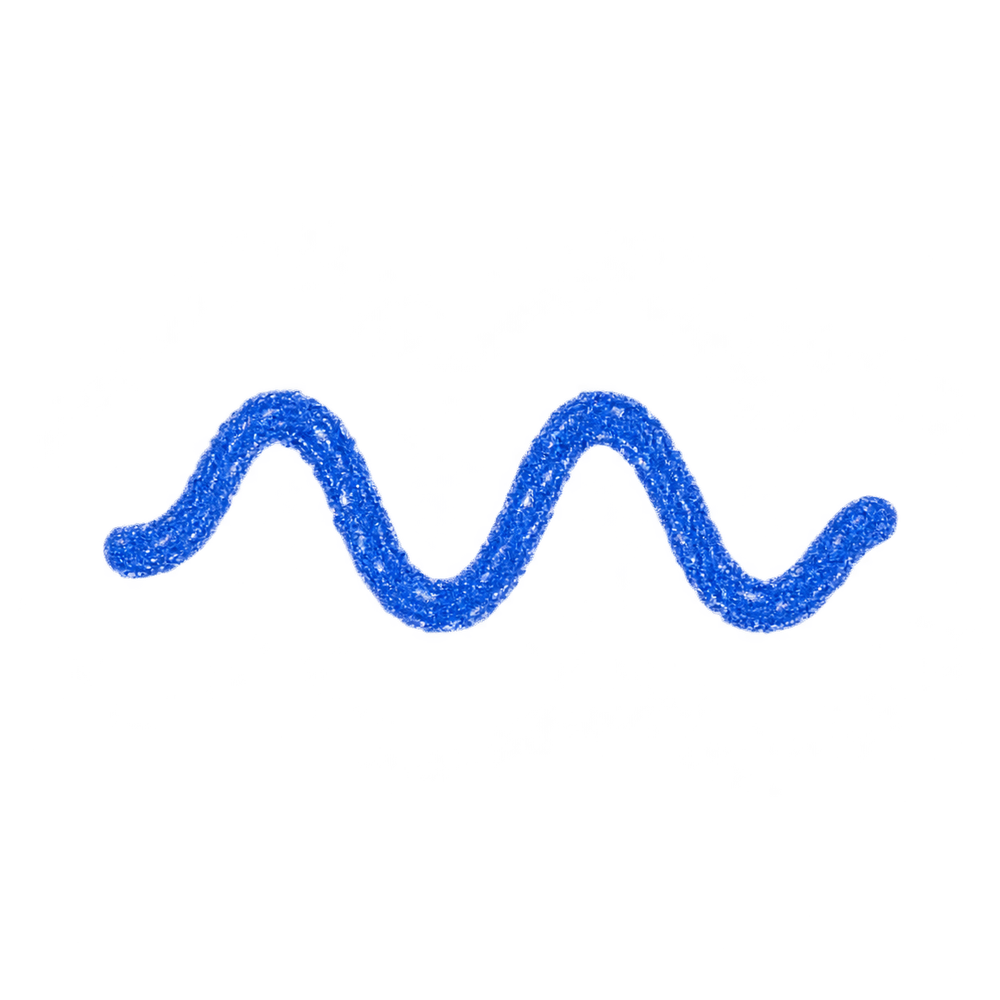
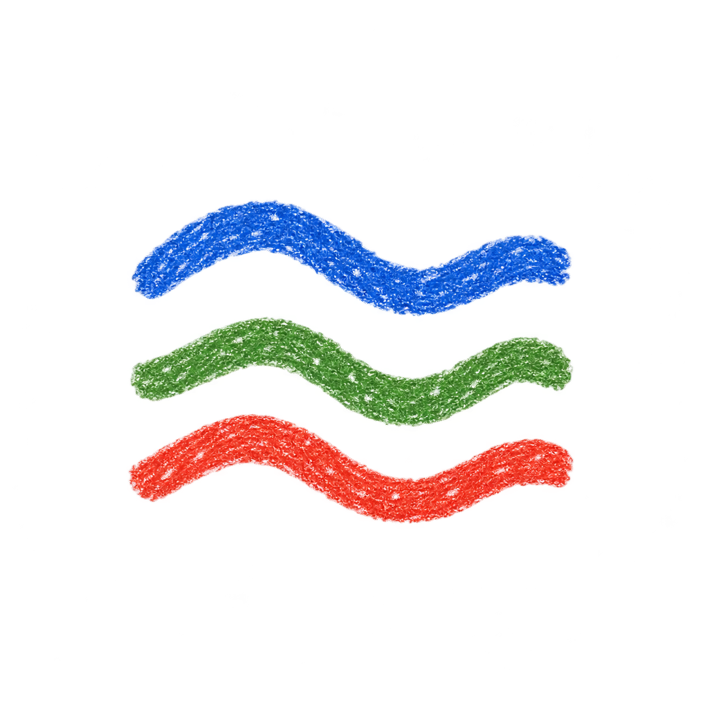
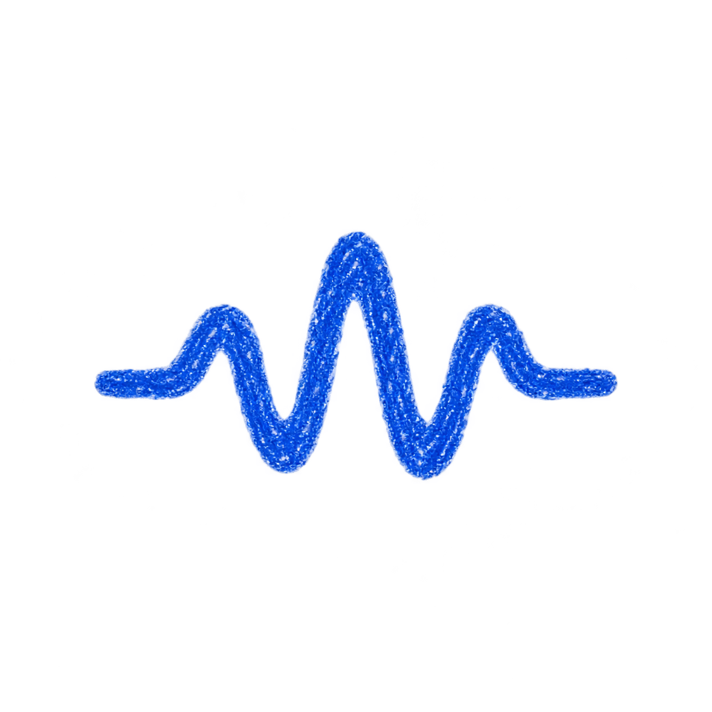
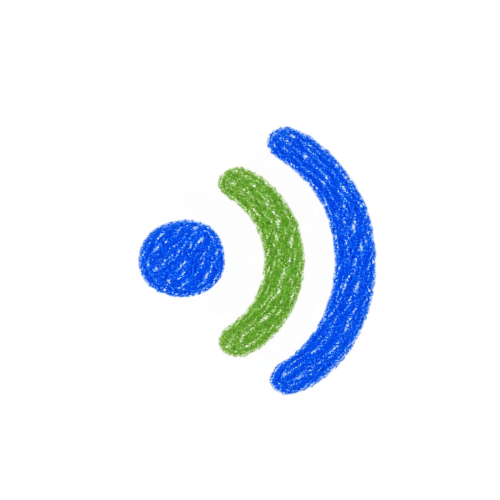
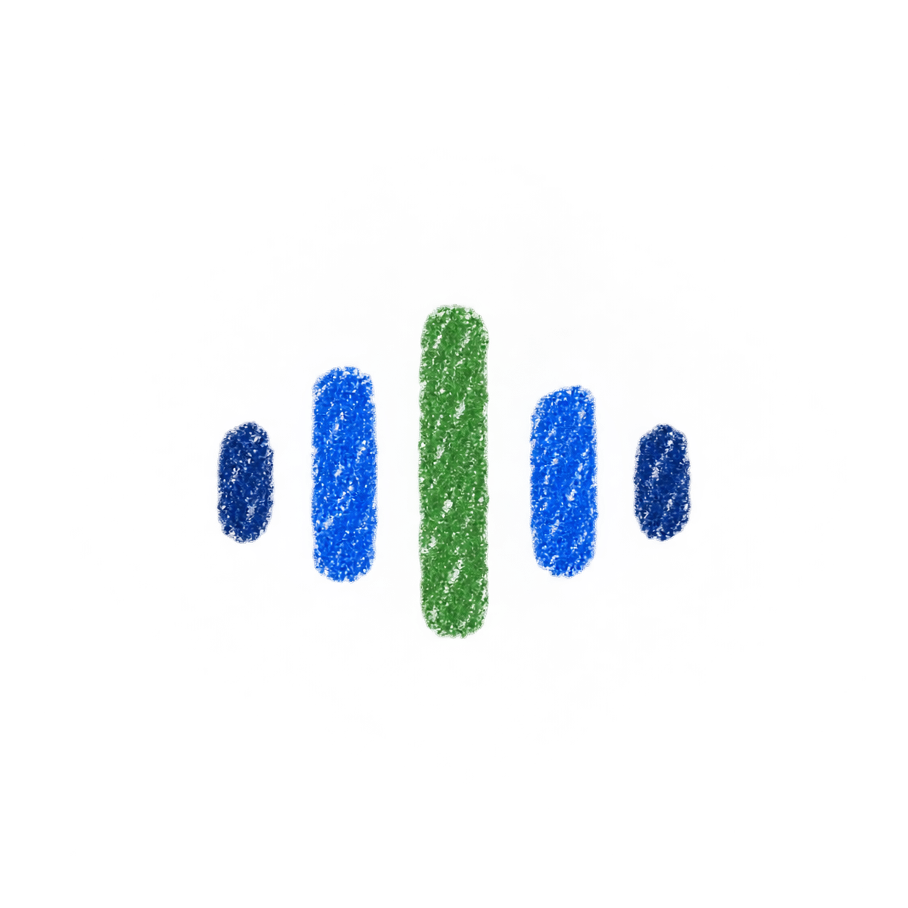

# Chit sound-wave explorations

Five additional concepts generated with the built-in imagegen tool.

## 06-flowing-wave

### Exact generation prompt

Use case: stylized-concept. Create ONE minimal avatar concept for Chit, a calm voice conversation companion. Same visual theme as naive crayon diary illustrations: authentic wax crayon / dry oil pastel pigment, short overlapping marks, tiny white paper flecks within rich color, softly irregular hand-drawn edges. Flat shapes on clean white subtly toothy paper. Square composition, single centered compact symbol about 45% canvas width, generous whitespace. Recognizable at small UI sizes and suitable for future voice-reactive animation. Calm, friendly, understated. No face, eyes, characters, lettering, labels, UI, decorative sparkles, borders, gradients, shadows, 3D, glossy effects or smooth vector finish. This is a sound symbol, not a detailed illustration. A single thick cobalt-blue crayon line flowing horizontally through two smooth rounded crests and two troughs, like a gentle sound oscillation. Continuous even-weight chunky line, softly blunted endpoints. Freehand imperfect sine wave, compact and balanced, no thin sharp spikes, no extra marks.

## 07-layered-hum

### Exact generation prompt

Use case: stylized-concept. Create ONE minimal avatar concept for Chit, a calm voice conversation companion. Same visual theme as naive crayon diary illustrations: authentic wax crayon / dry oil pastel pigment, short overlapping marks, tiny white paper flecks within rich color, softly irregular hand-drawn edges. Flat shapes on clean white subtly toothy paper. Square composition, single centered compact symbol about 45% canvas width, generous whitespace. Recognizable at small UI sizes and suitable for future voice-reactive animation. Calm, friendly, understated. No face, eyes, characters, lettering, labels, UI, decorative sparkles, borders, gradients, shadows, 3D, glossy effects or smooth vector finish. This is a sound symbol, not a detailed illustration. Exactly three separate thick undulating horizontal crayon lines stacked with generous white gaps. Top cobalt blue, middle leaf green, bottom warm tomato red. Each makes one gentle broad crest and trough, slightly different phase and length. A compact flowing sound-wave mark, no intersections, no frame.

## 08-voice-pulse

### Exact generation prompt

Use case: stylized-concept. Create ONE minimal avatar concept for Chit, a calm voice conversation companion. Same visual theme as naive crayon diary illustrations: authentic wax crayon / dry oil pastel pigment, short overlapping marks, tiny white paper flecks within rich color, softly irregular hand-drawn edges. Flat shapes on clean white subtly toothy paper. Square composition, single centered compact symbol about 45% canvas width, generous whitespace. Recognizable at small UI sizes and suitable for future voice-reactive animation. Calm, friendly, understated. No face, eyes, characters, lettering, labels, UI, decorative sparkles, borders, gradients, shadows, 3D, glossy effects or smooth vector finish. This is a sound symbol, not a detailed illustration. A single connected thick cobalt-blue crayon waveform drawn horizontally. Short level tails at both ends rise into a small rounded pulse, a taller rounded central pulse, then a small rounded pulse. Smooth flowing sound oscillations above AND below a shared invisible middle line, rounded extrema, absolutely no angular heartbeat spikes. One compact continuous mark.

## 09-sound-ripples

### Exact generation prompt

Use case: stylized-concept. Create ONE minimal avatar concept for Chit, a calm voice conversation companion. Same visual theme as naive crayon diary illustrations: authentic wax crayon / dry oil pastel pigment, short overlapping marks, tiny white paper flecks within rich color, softly irregular hand-drawn edges. Flat shapes on clean white subtly toothy paper. Square composition, single centered compact symbol about 45% canvas width, generous whitespace. Recognizable at small UI sizes and suitable for future voice-reactive animation. Calm, friendly, understated. No face, eyes, characters, lettering, labels, UI, decorative sparkles, borders, gradients, shadows, 3D, glossy effects or smooth vector finish. This is a sound symbol, not a detailed illustration. Minimal sound ripple symbol: a small solid cobalt-blue crayon oval at left and exactly two thick curved parenthesis-like crayon arcs opening toward it, expanding to the right. Inner arc leaf green, outer arc cobalt blue. Short rounded ends, generous white separation. Friendly organic sound radiating outward, three simple elements, no speaker box or musical note.

## 10-soft-frequency

### Exact generation prompt

Use case: stylized-concept. Create ONE minimal avatar concept for Chit, a calm voice conversation companion. Same visual theme as naive crayon diary illustrations: authentic wax crayon / dry oil pastel pigment, short overlapping marks, tiny white paper flecks within rich color, softly irregular hand-drawn edges. Flat shapes on clean white subtly toothy paper. Square composition, single centered compact symbol about 45% canvas width, generous whitespace. Recognizable at small UI sizes and suitable for future voice-reactive animation. Calm, friendly, understated. No face, eyes, characters, lettering, labels, UI, decorative sparkles, borders, gradients, shadows, 3D, glossy effects or smooth vector finish. This is a sound symbol, not a detailed illustration. Exactly five thick short vertical crayon dashes arranged along a shared horizontal centerline, alternating above and below that centerline only in their extent. Uneven rounded ends, heights low-medium-tall-medium-low, clear generous gaps. The outer two navy blue, adjacent two cobalt blue, central one leafy green. A compact soft audio waveform with hand-scribbled pigment, not a bar chart: all marks centered vertically, no baseline.

